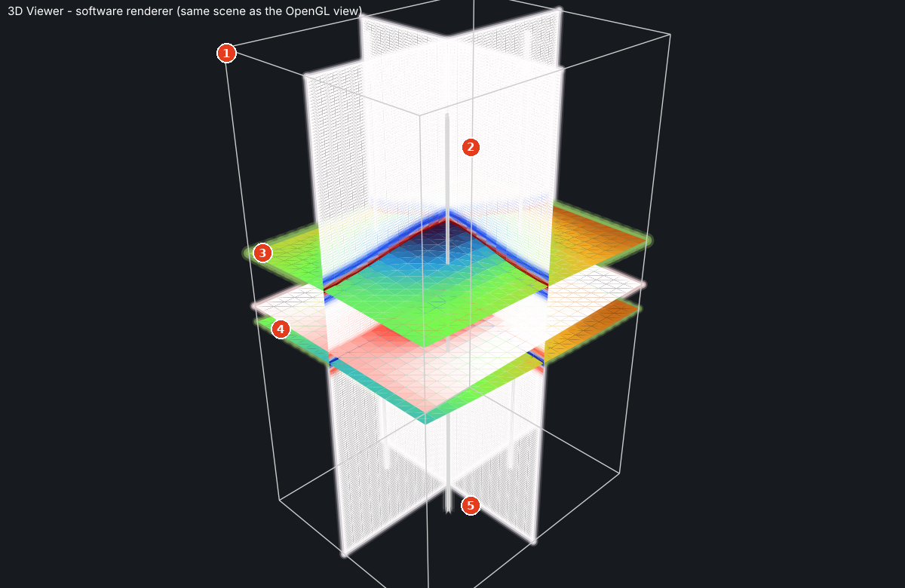
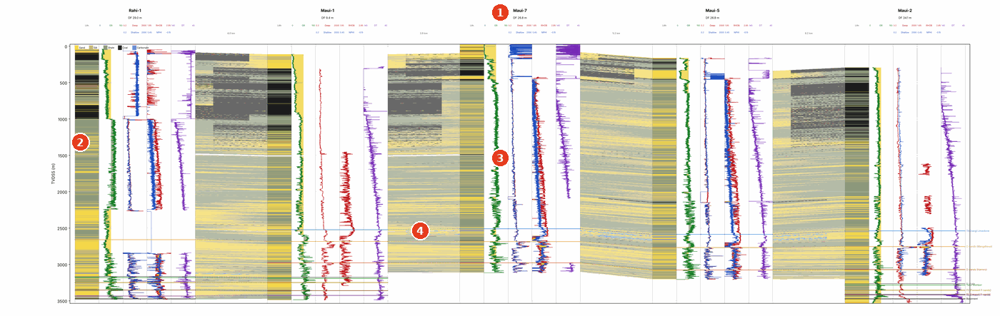
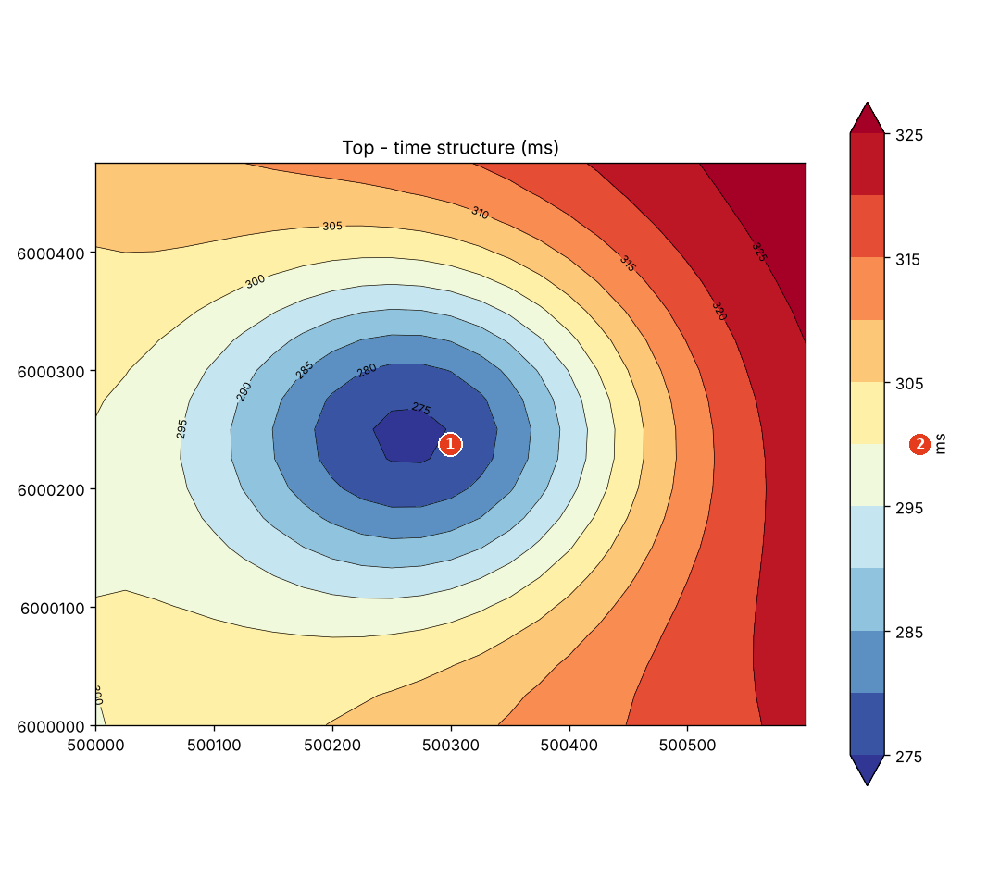
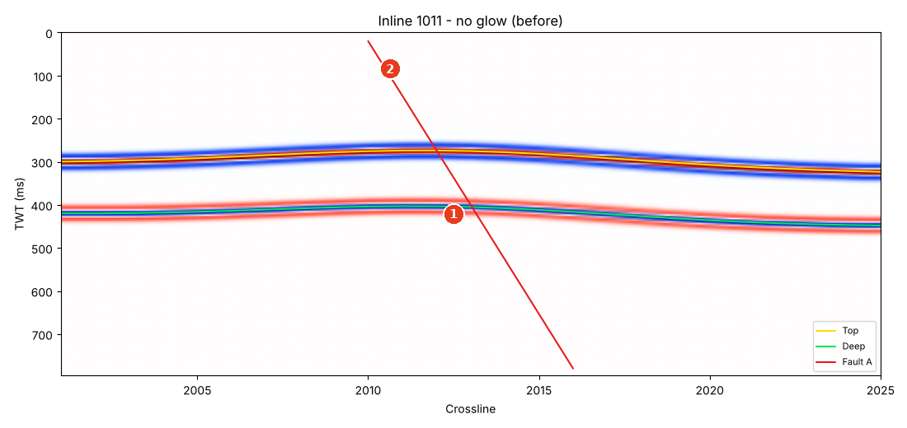
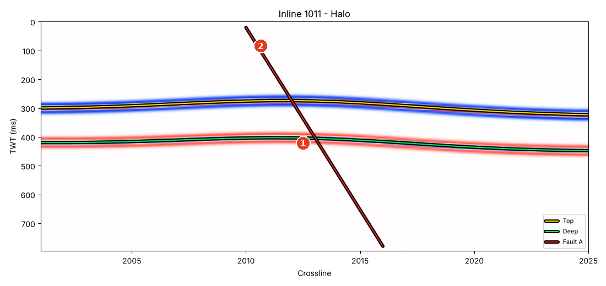
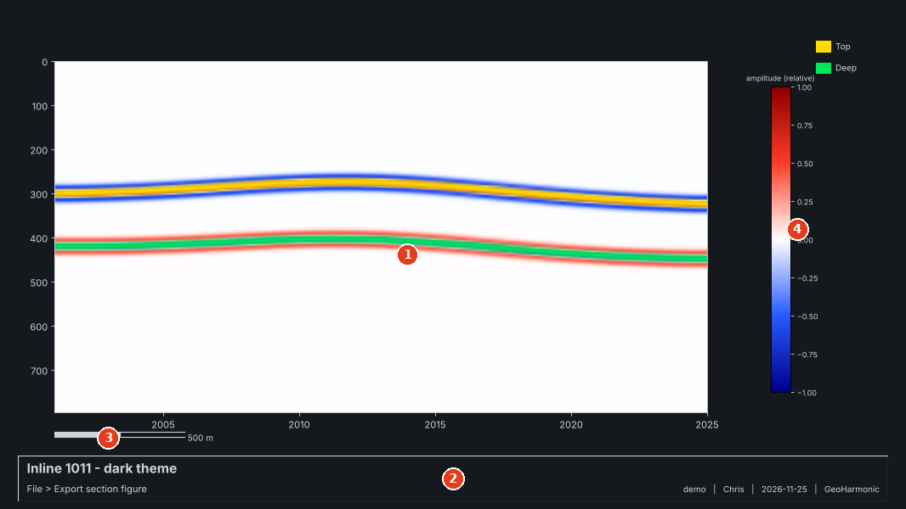
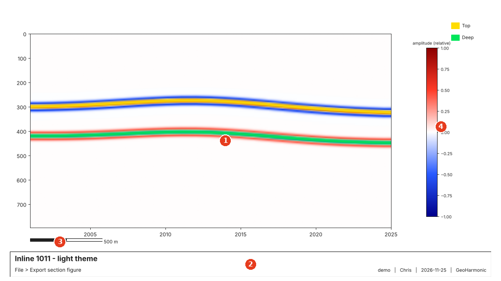
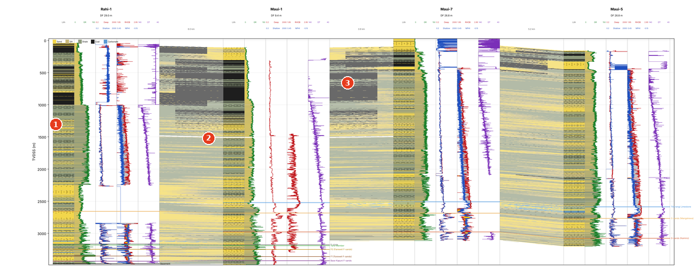

# GeoHarmonic - illustrated tutorial

*Generated by `dev/build_tutorial.py` on 25 Nov 2026 15:04 (build server: no Qt, tool exports only).*

This tutorial walks through every GeoHarmonic tool in the order you would use them on a project. Each chapter has
four parts: **How it looks** (screenshots of the real windows with numbered callouts), **How it works** (click by
click), **Results** (what you should see, plus the numbers the automatic tests prove on every build) and
**Known limits / troubleshooting**.

Menu paths are written like **Interpret > Velocity model + depth conversion...**. Keys are written like **Ctrl+S**.
"Seismic tool" means the *GeoHarmonic - Seismic Interpretation* window; "Well tool" means *GeoHarmonic - Well
Correlation*.

About the pictures: every screenshot is captured by `dev/build_tutorial.py` from the actual program on a small
synthetic demo project (3D cube, two horizons, three wells). Nothing is drawn by hand. When a window could not be
opened where the tutorial was built (the build server has no Qt), the caption says so and shows the tool's own
image export instead. When you run **Install GeoHarmonic.bat** on your PC it rebuilds the tutorial with real
window screenshots from your machine (see chapter 1) - the desktop shortcut *GeoHarmonic - Tutorial* opens that
copy.

## Contents

- [1. Install, update, test](#install)
- [2. Fixes in this release (first PC install, 25 Nov 2026)](#fixes)
- [3. Well Correlation (+ petrophysics window)](#wellcorr)
- [4. Mistie analysis (2D-2D, 2D-3D)](#mistie)
- [5. Seismic viewer, horizon + fault picking, autotracking](#seismic)
- [6. RGT, horizon stack, Wheeler, stratal slices](#rgt)
- [7. Well tie (synthetic seismogram)](#welltie)
- [8. Velocity model, dynamic depth conversion, velocity-volume mode](#velocity)
- [9. Map hub, Live Map and the map bus](#maps)
- [10. Basin model (burial, thermal, maturity) + Wheeler](#basin)
- [11. Seismic inversion (+ resolution, AVO / DHI)](#inversion)
- [12. Analytics + Dashboard](#analytics)
- [13. Automated fault mapping](#faultmap)
- [14. 3D Viewer](#view3d)
- [14b. Glow / Halo on horizons, faults and wells](#glow)
- [14c. Aesthetics: hillshade, colour tables, co-rendering, themes, figures](#aesthetics)
- [15. 3D interpretation (picking, tracking, volume rendering, geobodies)](#interp3d)
- [16. Structural framework + 3D grid](#framework)
- [17. Property modelling + volumetrics](#properties)
- [18. Prospects, migration, seal, spacing, depletion](#prospects)
- [19. Rebuilding this tutorial](#rebuild)

## 1. Install, update, test

Everything is started by double-clicking `.bat` files - no command window typing. The installer builds a private
Python environment (`.venv`) inside each tool folder, so nothing in your Anaconda install is changed.

### How it works

1. **After each build email: update.** Double-click **Update_GeoHarmonic.bat** on your Desktop. It pulls the latest `dev` branch into your GeoHarmonic folder. Wait for it to finish.
2. **Install / repair.** In the GeoHarmonic folder double-click **Install GeoHarmonic.bat** (if Windows says *Windows protected your PC*: *More info* > *Run anyway*). It takes 5-15 minutes the first time. It installs numpy 1.x, matplotlib, PySide6 6.5.3 and pyqtgraph 0.13.7 for the two Qt tools, numpy / scipy / matplotlib for the Mistie Tool, runs every self-test and every GUI test, rebuilds this tutorial with screenshots from your PC and makes the desktop shortcuts.
3. **Read the last lines.** The window ends with **ALL GOOD** or a list of problems. Problems are explained in `install_log.txt` (GeoHarmonic folder) and in `test_results.txt` inside each tool folder - send those files to Claude.
4. **Desktop shortcuts** made by the installer: *GeoHarmonic - Well Correlation*, *GeoHarmonic - Seismic Interpretation*, *GeoHarmonic - Mistie*, *GeoHarmonic - Tutorial* (this document).
5. **Re-run the tests only** (no reinstall): double-click **Run all tests.bat**. Results: `test_summary.txt` in the GeoHarmonic folder plus `test_results.txt` in each tool folder. Up to ~30 minutes.
6. **F3 Netherlands demo project:** download *F3 Demo 2023* (dGB / TerraNubis), then double-click **Set up F3 project.bat**. It builds `Documents\F3 Netherlands` (3D import, 4 wells with LAS + checkshots, 39 markers, 7 horizons, Fault A) in about 2 minutes.
7. **Uninstall:** **Uninstall GeoHarmonic.bat** removes the `.venv` folders and shortcuts; your projects stay.

### Results

The installer's last screen reads **ALL GOOD. Both tools are installed and every test passed.** The current test
counts on the build server are listed in chapter 2.

### Known limits

- The tools need Python 3.9-3.11 (PySide6 6.5.3 has no build for 3.12+). Anaconda with 3.11 is ideal.
- The first install needs internet (pip downloads); later runs only check the packages.

### Troubleshooting

- *Package install failed*: check the internet connection / VPN, then run the installer again.
- *Qt would not load*: send `install_log.txt` to Claude.
- A GUI test that hangs is stopped by a watchdog after 10 / 20 minutes and reported as FAILED with the place it was stuck - it never blocks the installer forever.

## 2. Fixes in this release (first PC install, 25 Nov 2026)

Your first install (Anaconda Python 3.11.3, PySide6 6.5.3, pyqtgraph 0.13.7, numpy 2.4.6) gave:

| Tool | Self-test | GUI test (real Qt, off screen) |
|---|---|---|
| Well Correlation | PASSED | PASSED (218 checks, 0 failures) |
| Seismic Interpretation | PASSED (~1,000 checks) | **FAILED** at the 3D Viewer |
| Mistie | PASSED | - |

**Bug 1 - 3D Viewer crash (fixed).** The error was
`AttributeError: 'PySide6.QtOpenGL.QOpenGLShaderProgram' object has no attribute 'glClearColor'`.
In plain words: the 3D window kept a "phone number" for the graphics card's drawing functions. Qt does not let
Python own that number, and handed it to the next object it created (the shader program). The next time the window
painted, it "dialled" the shader program instead of the graphics card. **Change:** the 3D window now asks Qt for
the drawing functions every time it paints, resizes or starts (`gui/view3d.py`), and keeps nothing stale.

**Bug 1b - one crash hid the rest of the GUI test (fixed).** Because the test stopped at the 3D Viewer, the
checks after it (3D interpretation, framework + 3D grid, properties) never ran on your PC. **Change:** every test
module now runs inside a guard: a crash is written as a FAIL with its full error text and the next module still
runs (Seismic and Well Correlation tools, and `tools/guitest_runner.py`).

**Bug 2 - "A module that was compiled using NumPy 1.x cannot be run in NumPy 2.4.6" at every start (fixed).**
PySide6 6.5.3 was built for NumPy 1. **Change:** the installers now ask for `numpy<2` for both Qt tools on every
run, so your existing `.venv` folders are moved back to numpy 1.26. The code was checked for NumPy-2-only calls.

**Noise - "QFontDatabase: Cannot find font directory" in the off-screen tests (fixed).** The GUI test runner now
points Qt at `C:\Windows\Fonts`.

### How it looks

*3D Viewer after the fix - the 3D Viewer's own software renderer (the picture the window shows when OpenGL is not available). The window itself could not be drawn where this tutorial was built (no Qt on the build server); Install GeoHarmonic.bat rebuilds this page with the real window.*

1. Survey box
2. Inline / crossline planes (seismic, red-white-blue)
3. Horizon 'Top' coloured by time
4. Time-slice plane and horizon 'Deep'
5. Well W-1 (tube)

### How it works

1. Double-click **Update_GeoHarmonic.bat** on the Desktop.
2. Double-click **Install GeoHarmonic.bat** in the GeoHarmonic folder. It downgrades numpy to 1.26 in both Qt tool environments (you will see *Installing numpy 1.x ...*) and re-runs every test.
3. Wait for **ALL GOOD**. In `tools\Seismic Interpretation Tool\test_results.txt` search for `38a`: the lines *38a: real OpenGL - initializeGL, paintGL x2, resize, paintGL* and *grabFramebuffer returns the rendered image* must say PASS (or SKIP + *software fallback* on a PC without OpenGL).
4. `install_log.txt` now shows *Qt OK - PySide6 6.5.3 - numpy 1.26.x* for both tools, and starting a tool no longer prints the NumPy 1.x warning.
5. Open the Seismic tool, **View > 3D Viewer** (**Ctrl+Shift+3**): the window title bar must not mention *software rendering* on your RTX card; drag the planes, orbit, zoom.

### Results

Before: the GUI test stopped with the AttributeError above. After (build server, Qt mock + software renderer):
the 3D Viewer draws the scene shown above, and the regression tests pass:

### Known limits

- The build server has no graphics card: the real-OpenGL regression test only runs on your PC (it is part of Install GeoHarmonic.bat / Run all tests.bat).

### Troubleshooting

- If the 3D Viewer still fails on your PC, it now switches to *software rendering* with the reason in the status bar instead of crashing - send `test_results.txt` to Claude.

## 3. Well Correlation (+ petrophysics window)

**What it is for.** The well-log correlation and tops tool - think Kingdom's cross-section / log correlation window or Petrel's Well
Section, plus a Geolog / IP-style petrophysics window. You pick formation tops on a flattened or structural
section, let the tool suggest tops in the other wells, and compute Vsh, porosity, Sw and net pay.

### How it looks

*Well Correlation main window (bundled NZ wells) - not captured (no Qt on the build server - the window cannot be drawn here). Install GeoHarmonic.bat rebuilds the tutorial on your PC with a real screenshot.*

*Correlation section export - the Well Correlation Tool's own section export (File > Export section image) on the bundled NZ wells. The window itself could not be drawn where this tutorial was built (no Qt on the build server); Install GeoHarmonic.bat rebuilds this page with the real window.*

1. Well name, datum and track headers
2. Lithology column
3. Log tracks (GR, resistivity, density / neutron, sonic)
4. Formation tops correlated between the wells

*Petrophysics window - not captured (no Qt on the build server - the window cannot be drawn here). Install GeoHarmonic.bat rebuilds the tutorial on your PC with a real screenshot.*

### How it works

1. Start **GeoHarmonic - Well Correlation**. **File > New project from data folder...** (**Ctrl+N**) and pick the folder with your LAS files (one sub-folder per well works too), or **File > Open project...** (**Ctrl+O**). The F3 set-up makes `Documents\F3 Netherlands\F3 wells` for you.
2. Click wells on the map (left) to put them on the section; drag them to reorder.
3. **Edit > Pick tops** (**P**), choose the formation, click on a log track to place the top. **Ctrl+Z** / **Ctrl+Y** undo / redo.
4. **Correlate > Suggest active top in selected well** (**S**) or *in all section wells missing it* (**Shift+S**); accept with **Enter**, reject with **Esc**. **G** shows a ghost curve at the cursor.
5. **Correlate > Zone statistics...** (**Z**) for averages per zone; **Correlate > Compare tops with reference...** (**R**) to check against a published tops list.
6. **Petrophysics > Petrophysics window...** (**Ctrl+Shift+P**): curve QC, Vsh, porosity, Sw (Archie / Simandoux / Indonesia), multimineral solve, Monte-Carlo uncertainty, net-pay cut-offs, rock physics.
7. **File > Export section image (PNG/PDF)...** (**Ctrl+E**); **File > Export tops > Kingdom tops** or *OpendTect well markers* for the other packages. **Ctrl+S** saves.

### Results

A section with your tops, correlation fill between wells and the petrophysics tracks. The self-test proves the
LAS / DLIS reading, top suggestion and petrophysics against hand-computed answers:

### Known limits

- Deviated wells are drawn along MD in the section (TVD shading in the petro window).

### Troubleshooting

- *Logs look flat / missing*: **File > Reload logs (rebuild cache)**.
- A well with no logs is listed by the self-test check `--check <folder>` in the README.

## 4. Mistie analysis (2D-2D, 2D-3D)

**What it is for.** Measures and solves the time, phase and gain misties between 2D lines and 3D surveys - the equivalent of Kingdom's
Mistie Analysis / Petrel's Seismic Well Tie mistie tools. There are two ways in: the stand-alone **GeoHarmonic -
Mistie** tool (for the NPRA-style 2D line sets) and **Interpret > Mistie analysis (2D-3D, 2D-2D)...** inside the
Seismic tool.

### How it looks

*Mistie analysis dialog - not captured (no Qt on the build server - the window cannot be drawn here). Install GeoHarmonic.bat rebuilds the tutorial on your PC with a real screenshot.*

### How it works

1. Seismic tool: load your 2D lines (**File > Add 2D SEG-Y lines...**, **Ctrl+2**) and the 3D (**File > Import 3D SEG-Y...**, **Ctrl+3**).
2. **Interpret > Mistie analysis (2D-3D, 2D-2D)...** finds every line crossing and measures shift, phase and gain by cross-correlation in the window you set.
3. Tick **Robust (down-weight ties that disagree with the network)** so one bad tie cannot pull the network; hold a key line fixed. Options: **Flex mode**, **Tie overlapping / duplicate lines along the overlap**, **Time-variant shift for lines crossing a 3D**.
4. Apply the solution; the corrected lines are used everywhere (sections, tracking, maps). The misties are drawn on the Live Map as coloured markers.
5. Stand-alone tool: double-click **GeoHarmonic - Mistie**, open the config JSON (e.g. `examples_npra_config.json`), *Run*. Its tie table can be linked into the Seismic tool.

### Results

The tests build lines with known misties and recover them:

### Known limits

- Time-variant mistie only for 2D lines that cross a 3D.

### Troubleshooting

- *No ties found*: the 2D navigation must be in the same coordinate system as the 3D (**File > Add 2D navigation CSV...**).

## 5. Seismic viewer, horizon + fault picking, autotracking

**What it is for.** The main interpretation window - Kingdom's Vertical Seismic View + Map View in one. Inline / crossline / time slice
/ 2D line display, horizon picking with seeded autotracking, fault sticks, attributes, co-blending and wells on
the section.

### How it looks

*Seismic Interpretation main window - not captured (no Qt on the build server - the window cannot be drawn here). Install GeoHarmonic.bat rebuilds the tutorial on your PC with a real screenshot.*

*Inline with picked horizons - plotted by the tutorial builder from the demo project's volume and horizons (not a window). The window itself could not be drawn where this tutorial was built (no Qt on the build server); Install GeoHarmonic.bat rebuilds this page with the real window.*

1. Seismic (red-white-blue), TWT down
2. Horizons Top / Deep (picked)

### How it works

1. Start **GeoHarmonic - Seismic Interpretation**. **File > New project...** (**Ctrl+N**), then **File > Import 3D SEG-Y...** (**Ctrl+3**) and/or **File > Add 2D SEG-Y lines...** (**Ctrl+2**). Big files are read from disk on demand (no full load).
2. Pick the line in the toolbar (Inline / Crossline / Time slice and its number). **PgDown / PgUp** step to the next / previous line.
3. Horizons panel: **New** (or **Interpret > New horizon...**), then **Pick mode (P)** and click seeds on the reflector.
4. **Track (T)** (**Interpret > Track horizon from seeds**) autotracks peak / trough / zero crossing from your seeds across the 3D and onto crossing 2D lines; it stops at faults. **Ctrl+Z** undoes the last edit or tracking run.
5. Faults panel: **New (N)**, **Fault mode (F)**, click points of a stick, **End stick (Enter)**.
6. **File > Link well project...** shows the Well tool's wells, logs and tops on the section.
7. **View > Co-blend attributes on the section (RGB / CMY / HSV)...**, **View > Attribute overlay...** and **View > Bump-map the section / slice** for SeisWare-style displays. **Ctrl+S** saves.

### Results

The tracker is tested on folded, noisy and faulted synthetic data:

### Known limits

- Tracking from the 3D window is described in chapter 15; both write the same horizon.

### Troubleshooting

- *Tracking runs through noise*: raise **Min correlation** in the Horizons panel; set **Lateral mix 2D** to 5-9 traces for noisy land 2D; keep **Tracker stops at faults** ticked.

## 6. RGT, horizon stack, Wheeler, stratal slices

**What it is for.** PaleoScan-style relative geologic time: a dip field, a global RGT solve, then hundreds of iso-RGT horizons (the
horizon stack), a Wheeler (chronostratigraphic) display and stratal slices.

### How it works

1. **Interpret > Compute dip field (current 3D volume)...**.
2. **Interpret > Compute RGT (current 3D volume)...** (or *all 2D lines*). Optional constraints: **Interpret > Use active horizon as RGT constraint**, **Well seeds from tied tops**.
3. **Interpret > Build horizon stack (3D)...**; browse the levels on the section; **Interpret > Convert stack level to horizon...** keeps one as a normal horizon.
4. Fix the model where needed: **Interpret > RGT edit mode on/off** (**E**) - click a level, then click where it belongs; **Re-link RGT around active fault** for cross-fault links.
5. Wheeler: set the section's domain box to **Wheeler** (vertical axis = relative geologic time, gaps = hiatus) or **Wheeler (age)** (Ma, from the Basin model age table); tick **RGT contours** to draw the stack levels.

### Results

RGT accuracy on synthetic geology with a fault and a pinch-out:

### Known limits

- The RGT is stored as uint16 per sample (precision about 1/65,000 of the time range).

### Troubleshooting

- *Levels jump across a fault*: pick the fault first, then **Re-link RGT around active fault**.

## 7. Well tie (synthetic seismogram)

**What it is for.** Hampson-Russell-style well tie: synthetic from sonic + density, auto-correlate (bulk shift + stretch), constrained
stretch / squeeze (DTW), wavelet estimation, drift QC against the checkshot, and multi-well batch ties.

### How it looks

*Well tie dialog - not captured (no Qt on the build server - the window cannot be drawn here). Install GeoHarmonic.bat rebuilds the tutorial on your PC with a real screenshot.*

### How it works

1. Link the well project (**File > Link well project...**), then **Interpret > Well tie (synthetic seismogram)...** and pick the well.
2. **Find best trace** searches around the well; **Auto tie** gives bulk shift + stretch with the correlation before / after.
3. **Auto stretch/squeeze** (with a velocity-change cap) or **Pick event pair** for manual ties; **Undo** / **Clear warp**.
4. **Estimate wavelet** / **Save wavelet**; **Drift QC** compares the tied T-D with the checkshot.
5. **Save tie** writes the time-depth table used by depth conversion and the velocity volume. **Tie all wells...** runs the batch.

### Results

Known shifts and velocity errors are recovered:

### Known limits

- Sonic-only wells use a Gardner density.

### Troubleshooting

- *Poor correlation*: despike logs (**Despike logs**), check the polarity, use a window tie.

## 8. Velocity model, dynamic depth conversion, velocity-volume mode

**What it is for.** Kingdom Dynamic Depth Conversion: a layer-cake velocity model from horizons + tops (V0+kZ, interval velocities,
checkshots), residual gridding so the depth maps tie every top, scenarios and blind tests - and an advanced
**velocity-volume** mode built from the well-tie velocities (tops stay the hard data).

### How it looks

*Velocity model + depth conversion dialog - not captured (no Qt on the build server - the window cannot be drawn here). Install GeoHarmonic.bat rebuilds the tutorial on your PC with a real screenshot.*

*Velocity volume (advanced) dialog - not captured (no Qt on the build server - the window cannot be drawn here). Install GeoHarmonic.bat rebuilds the tutorial on your PC with a real screenshot.*

### How it works

1. **Interpret > Velocity model + depth conversion...**: list the layers (time horizon + matching top), pick the method per layer, **Build model**.
2. **Depth map of selected layer**, **Cross-plot of selected layer**, **Export misfit CSV...**; **Use for depth display** switches sections to depth.
3. What-if wells: **Add pseudo-top**; scenarios: **Save scenario**, **Difference map vs scenario**.
4. Dynamic: **View > Auto-update depth model (dynamic depth conversion)** rebuilds the maps whenever you pick a top or change a horizon.
5. Advanced: **Interpret > Velocity volume depth conversion (advanced)...** - **a. Well velocities** (from the saved well ties, QC flags), then **b-e. Build + tie to tops** (layering, interpolation, optional stacking-velocity trend, residual gridding). **Blind test vs layer-cake**, **Store volume**, **Maps to map hub**.
6. **Depth-convert volume to SEG-Y...** writes a depth cube.

### Results

Depth maps tie the tops exactly; the volume mode is tested against the layer-cake:

### Known limits

- The velocity-volume model is not yet used by *Use for depth display* in the section (follow-up).

### Troubleshooting

- *Maps do not tie a top*: check the top is in the layer's top list and not flagged as an outlier.

## 9. Map hub, Live Map and the map bus

**What it is for.** The Kingdom-style base map. The **Map layers** panel (left of the Seismic tool) holds grids, wells, culture,
shapefiles, petrophysics bubbles / pies, cokriging and the GIS / QGIS link. **View > Live Map** is a dark,
Spotfire-style map with styled wells, filters, lasso selection and a linked table / crossplot / histogram. The
**map bus** keeps every window in sync: select a well in the Well tool and it lights up in the Live Map and the 3D
Viewer; move the inline in the Seismic tool and the map line moves.

### How it looks

*Live Map - the Live Map's own PNG export (Export map (PNG / PDF)...). The window itself could not be drawn where this tutorial was built (no Qt on the build server); Install GeoHarmonic.bat rebuilds this page with the real window.*

1. Map: survey outline and wells styled by a demo column Mistie_ms (rule colours > 10 ms red, > 5 ms orange; bubble size + label = value)
2. Title block (title, project, date)
3. Location inset
4. Legend (layers + well style)
5. Scale bar
6. North arrow

*Horizon map - the horizon-map PNG export of the map hub. The window itself could not be drawn where this tutorial was built (no Qt on the build server); Install GeoHarmonic.bat rebuilds this page with the real window.*

1. Gridded horizon time with contours
2. Colour bar (ms)

### How it works

1. **Interpret > Horizon maps (structure, isochron, amplitude, depth)...** (**Ctrl+M**) grids a horizon onto the base map.
2. In **Map layers** click **Add...** for grids, CPS-3 files, petrophysics per well, mineral pies, shapefiles / culture (leases, PLSS, pipelines, no-go), DHI checklist, migration, grid calculator, cross-check, EPSG and GIS export.
3. **View > Live Map (styled wells, filters, linked table + crossplot)...**: in *Well style* choose *Colour by* / *Size by* / *Shape by* / *Label* columns (rules such as *mistie > 10 ms = red* under *Rules*), **Apply style**.
4. *Filters*: **Add filter** (range slider or category ticks) hides wells instantly; **Clear filters**.
5. **Lasso select** (click around wells, double-click to close) - the table, crossplot and histogram below follow; **Section from selected wells** opens them in the Well tool.
6. **Arbitrary line** (click points, double-click the last) opens an arbitrary section in the Seismic tool.
7. **Live grid...** grids a WellTable column or picks while you work; **Live depth maps** follow the dynamic depth model.
8. **Export map (PNG / PDF)...** with title block + legend; **Export GIS (shapefile, GeoJSON, ZMAP+)...**.

### Results

Map bus, styling, filters and gridding are tested without and with the GUI:

### Known limits

- Polygon fills ignore holes; the Dashboard keeps its own selection (not yet on the bus).

### Troubleshooting

- *Wells do not light up across tools*: both tools must open the same well project (the bus files live in `<well project>_mapbus`).

## 10. Basin model (burial, thermal, maturity) + Wheeler

**What it is for.** A 1D / pseudo-3D basin model in the spirit of PetroMod 1D / Genesis: decompaction and burial history, heat flow
and temperature, EASY%Ro maturity, timing of generation, all linked to the Wheeler diagram.

### How it looks

*Basin model dialog - not captured (no Qt on the build server - the window cannot be drawn here). Install GeoHarmonic.bat rebuilds the tutorial on your PC with a real screenshot.*

### How it works

1. **Interpret > Basin model (burial, thermal, maturity, Wheeler)...**.
2. Tab **Age table**: layers with ages, lithologies, erosion; tab **Wells**: the wells to model, heat flow; run. Tick **Re-run when the depth model changes** to keep it live.
3. Tab *Maps / Wheeler / events*: maturity maps, **Colour Wheeler (age)**, the events chart (source, reservoir, seal, trap, generation).

### Results

Checked against analytic solutions:

### Known limits

- 1D per well / grid node (no lateral heat or fluid flow).

### Troubleshooting

- *Ro too high*: check the erosion amounts and heat flow history.

## 11. Seismic inversion (+ resolution, AVO / DHI)

**What it is for.** Hampson-Russell STRATA-style post-stack and pre-stack inversion: low-frequency model (LFM) from wells and horizons,
model-based / sparse-spike post-stack inversion, simultaneous pre-stack inversion (AI, SI, Vp/Vs), plus a
resolution / tuning check, single-well inversion and AVO / DHI / fizz-gas tools.

### How it looks

*Seismic inversion dialog - not captured (no Qt on the build server - the window cannot be drawn here). Install GeoHarmonic.bat rebuilds the tutorial on your PC with a real screenshot.*

### How it works

1. **Interpret > Seismic inversion (LFM, post-stack, pre-stack)...**.
2. Tab **Low-frequency model**: wells + horizons as the framework (or **along RGT stack levels instead**); tab **Post-stack** or **Pre-stack** to run; results are new volumes you can show on sections, in the 3D Viewer and as map layers.
3. **Resolution...** asks for the window, interval velocity and bed thicknesses and says which beds are resolved.
4. **AVO volumes (intercept, gradient, anomaly, fluid factor)** from a near and a far stack.

### Results

Inversion and AVO are tested on synthetic earths with known answers:

### Known limits

- Pre-stack gathers are not stored yet - angle stacks are used.

### Troubleshooting

- *Blocky result*: lower the sparsity weight or add a horizon to the LFM.

## 12. Analytics + Dashboard

**What it is for.** Transform / Spotfire-style data science: an attribute table (wells, laterals, grid values), feature engineering,
models with honest validation (spatial blocks), SHAP-style explanations and a QC report; and a Dashboard that colours
wells / laterals by any attribute, with spacing ellipses and a gun-barrel view.

### How it looks

*Analytics window - not captured (no Qt on the build server - the window cannot be drawn here). Install GeoHarmonic.bat rebuilds the tutorial on your PC with a real screenshot.*

*Dashboard window - not captured (no Qt on the build server - the window cannot be drawn here). Install GeoHarmonic.bat rebuilds the tutorial on your PC with a real screenshot.*

### How it works

1. **Interpret > Analytics (attribute table, models, SHAP)...**: build the table, pick target + inputs, train, read the *Model QC* report.
2. **Interpret > Dashboard (wells, laterals coloured by attribute)...**: **Wells from project**, **Add basemap grid**, **Stage CSV...**, colour by a column, **Send to Analytics**.
3. Reservoir engineering from the Dashboard toolbar: **Spacing + ellipses...** (SHmax azimuth asked), **Gun barrel**.

### Results

The models are validated on synthetic data with known drivers:

### Known limits

- Optional xgboost / scikit-learn / shap via *Install analytics extras (optional).bat*; numpy models otherwise.

### Troubleshooting

- *Too-good model*: use the spatial block validation, not random splits.

## 13. Automated fault mapping

**What it is for.** PaleoScan AFE-style automatic faults: fault-likelihood, thinned fault likelihood (TFL), strike and dip volumes,
fault skins, a stereonet / rose QC, faults with sticks for the interpretation, throws and fault polygons on
horizons (used as gridding barriers).

### How it looks

*Automated fault mapping dialog - not captured (no Qt on the build server - the window cannot be drawn here). Install GeoHarmonic.bat rebuilds the tutorial on your PC with a real screenshot.*

### How it works

1. **Interpret > Automated fault mapping (fault likelihood, auto faults, polygons)...**.
2. **1. Fault likelihood volumes** (note the run time on F3).
3. **2. Extract faults**: set *TFL threshold* and *Minimum fault size (points)*; check the stereonet / strike rose; filter and merge in the table.
4. **3. Create faults (sticks)** - they appear in the Faults panel like hand-picked faults.
5. **Fault polygons on active horizon** for the map; **2D lines: fault cuts + correlation** for 2D.

### Results

Faults with known strike / dip / throw are recovered:

### Known limits

- Orientation from a structure tensor (not a brute-force scan) - same answer, much cheaper.

### Troubleshooting

- *Too many small faults*: raise the minimum size or the TFL threshold.

## 14. 3D Viewer

**What it is for.** A Petrel-style 3D window: inline / crossline / time-slice planes through the volume, horizons as surfaces, faults,
wells with tops, culture, vertical exaggeration and saved views. It uses your graphics card (OpenGL) and falls back
to software rendering when OpenGL cannot start (it says so in the title).

### How it looks

*3D Viewer - the 3D Viewer's own software renderer (the picture the window shows when OpenGL is not available). The window itself could not be drawn where this tutorial was built (no Qt on the build server); Install GeoHarmonic.bat rebuilds this page with the real window.*

1. Survey box
2. Inline / crossline planes (seismic, red-white-blue)
3. Horizon 'Top' coloured by time
4. Time-slice plane and horizon 'Deep'
5. Well W-1 (tube)

### How it works

1. Seismic tool: **View > 3D Viewer (slices, horizons, faults, wells)...** (**Ctrl+Shift+3**).
2. Mouse: left drag = orbit, middle drag or **Shift**+left = pan, wheel = zoom; **Fit** resets.
3. Move a plane with the *Inline* / *Crossline* / *Time slice* sliders - coarse while dragging, full resolution when you let go; the Seismic tool follows (and vice versa).
4. *Objects* tree: tick objects on / off, set opacity; the **VE** box in the toolbar sets vertical exaggeration.
5. **Save view**, **Screenshot...**, **Turntable GIF...**.

### Results

Planes, meshes, picking and the map-bus links are tested; on your PC the OpenGL path too:

### Known limits

- Very large planes are drawn with per-vertex colours (decimated while dragging).

### Troubleshooting

- Title says *software rendering*: OpenGL could not start (remote desktop / driver). Update the NVIDIA driver; the reason is in the status bar.

## 14b. Glow / Halo on horizons, faults and wells

**What it is for.** A PowerPoint-style glow (or a solid contrasting halo) under interpretation lines so horizons, faults and wells stand
out on busy seismic - in the section, the Live Map and the 3D Viewer. The active / selected object glows stronger;
selecting a horizon, fault or well in any window makes it glow in every window (map bus). Kingdom and Petrel have no
equivalent; it is closest to Petrel's "highlight selected object".

### How it looks

*Before: horizons and a fault without glow - the Seismic tool's own section export (File > Export section image) on the demo inline - glow as on screen. The window itself could not be drawn where this tutorial was built (no Qt on the build server); Install GeoHarmonic.bat rebuilds this page with the real window.*

1. Horizons Top / Deep, plain lines
2. Fault A

*After: Glow mode - the Seismic tool's own section export (File > Export section image) on the demo inline - glow as on screen. The window itself could not be drawn where this tutorial was built (no Qt on the build server); Install GeoHarmonic.bat rebuilds this page with the real window.*

1. Horizons Top / Deep with their glow
2. Fault A

*After: Halo mode - the Seismic tool's own section export (File > Export section image) on the demo inline - glow as on screen. The window itself could not be drawn where this tutorial was built (no Qt on the build server); Install GeoHarmonic.bat rebuilds this page with the real window.*

1. Horizons Top / Deep with a black halo
2. Fault A

### How it works

1. Seismic tool: press **G** (or **Display > Glow on/off**) to switch glow on / off everywhere.
2. **Display > Glow settings (mode, width, intensity, colour)...**: *Mode* Glow / Halo / Off, *Width* (pixels), *Intensity*, *Falloff layers* 1-4, *Glow colour* (match the object / white / black / custom), *Halo colour* (Auto picks black or white against the current colour table), *Glow only the active / selected object*, *Hover highlight*, *Exports include glow*. **Apply** or **OK**; saved with the project (**Ctrl+S**).
3. Quick switches: **Display > Glow mode: Glow**, **Display > Glow mode: Halo**, **Display > Glow only the active / selected object**.
4. Per object: right-click a horizon in the *Horizons* panel or a fault in the *Faults* panel (or an object in the 3D Viewer's *Objects* tree) > **Glow** > *On* / *Off* / *Use global* / *Colour...*.
5. Move the mouse over a horizon or fault on the section: it highlights (hover).
6. **File > Export section image (PNG / PDF / SVG)...** (**Ctrl+E**): choose *With glow (as shown)* or *Export without glow*. The 3D Viewer's **Screenshot...** asks the same; **Turntable GIF** follows the *Exports include glow* setting.
7. 3D Viewer: **Glow (G)** in the toolbar; surfaces get an outline glow, the active / selected one also a soft shell; wells a wider transparent tube; the three plane outlines glow.

### Results

The pictures above are the tool's own section export (before / Glow / Halo). The tests check:

### Known limits

- Pictures here are on the small demo cube; on F3 open an inline with your horizons and a fault and press G to compare.
- Wide glow lines in 3D depend on the graphics driver; when it cannot draw them the glow is 1 px wide or off, with a one-line note in the 3D status bar (never a crash).
- More than 2,000 glowing objects (e.g. thousands of fault sticks): glow switches to the active / selected objects only and the status bar says so.

### Troubleshooting

- *Nothing glows*: press **G** once (glow may be off), check **Display > Glow only the active / selected object** is unticked, and that the object has no per-object *Off*.
- *Glow looks too heavy*: Glow settings > Width 3-4 px, Intensity 50 %, or switch to Halo.

## 14c. Aesthetics: hillshade, colour tables, co-rendering, themes, figures

**What it is for.** Display polish shared by every window: sun-lit (hillshaded) maps and 3D surfaces, one colour-table library (seismic
bars incl. Kingdom-style, perceptual viridis / cividis / magma-style tables, colourblind-safe ones marked, your own
tables saved in the project), co-rendering of a second volume over the amplitude (like Petrel's co-render /
Kingdom's overlay), dark and light themes, smooth camera moves, styled well-log tracks and one-click figures with a
title block for slides and reports.

### How it looks

*Hillshaded horizon map - the figure export (Export section figure / compose_figure) with the 40a hillshade on the demo horizon. The window itself could not be drawn where this tutorial was built (no Qt on the build server); Install GeoHarmonic.bat rebuilds this page with the real window.*

1. Plain colour fill
2. Same map lit by the sun (hillshade)
3. Title block

*Co-rendered envelope over amplitude - View > Co-render ... (aesthetics.corender) on the demo inline, shown with the figure export. The window itself could not be drawn where this tutorial was built (no Qt on the build server); Install GeoHarmonic.bat rebuilds this page with the real window.*

1. Amplitude, red-white-blue
2. Envelope over it, low values transparent

*Exported figure, dark theme - File > Export section figure (the code behind it) on the demo inline, dark theme. The window itself could not be drawn where this tutorial was built (no Qt on the build server); Install GeoHarmonic.bat rebuilds this page with the real window.*

1. Section with glowing horizons
2. Title block (title, project, author, date)
3. Scale bar
4. Colour bar + legend

*Exported figure, light theme - File > Export section figure (the code behind it) on the demo inline, light theme. The window itself could not be drawn where this tutorial was built (no Qt on the build server); Install GeoHarmonic.bat rebuilds this page with the real window.*

1. Section with glowing horizons
2. Title block (title, project, author, date)
3. Scale bar
4. Colour bar + legend

*Styled correlation panel - the Well Correlation Tool's section export with View > Track style turned on (bundled NZ wells). The window itself could not be drawn where this tutorial was built (no Qt on the build server); Install GeoHarmonic.bat rebuilds this page with the real window.*

1. Lithology column with patterns
2. GR gradient fill (sand yellow -> shale)
3. Neutron-density crossover shading

### How it works

1. **Sun / hillshade (maps):** Live Map toolbar **Sun...**: drag the sun on the dial (direction = azimuth, nearer the centre = higher), set *Vertical exaggeration*, *Blend with colour*, *Multi-directional*. Every grid on the map is lit; the 3D Viewer's horizons are lit by the same sun.
2. **Colour tables:** the colour box above the section lists the library; colourblind-safe tables are marked. Custom tables are saved with the project (export / import as JSON or a 256-row CSV).
3. **Co-render:** **View > Co-render a volume / attribute (alpha, multiply, transparency)...**: pick a second volume (e.g. coherence) or an attribute, the blend mode, its colour table and opacity. *Multiply* darkens the seismic where coherence is low; *transparency* hides low values. In 3D the same on the planes.
4. **Theme:** **View > Theme > Dark** or **Light (print / slides)** - switches immediately, remembered next time. **View > Anti-aliasing** off = faster drawing on huge sections.
5. **3D display:** 3D Viewer toolbar **Display...**: sun on/off, eye-dome lighting, fog, shadows (falls back to plain lighting), fly-to speed (Off / Fast / Normal / Slow). Selecting a well or horizon on the Live Map flies the 3D camera to it; any mouse click stops the move. Live Map **Zoom to selection** eases in.
6. **Well tracks (Well tool):** **View > Track style**: GR gradient fill, lithology patterns, net / pay flags (Vsh / PHIE / Sw cutoffs), neutron-density crossover; **Save track style as template...** / **Apply track template...**.
7. **Figures:** Seismic tool **File > Export section figure (title block, scale bar, legend)...**: page (16:9 slide, Letter, A4, poster), title; PNG / PDF / SVG. The 3D Viewer has the same for its view.
8. **Automatic colours:** new horizons / faults get colours that differ from each other and from the seismic colour table; right-click > **Lock colour**; **Display > Reassign horizon + fault colours**.

### Results

Pictures: the tools' own exports on the demo data. The tests check:

### Known limits

- Eye-dome lighting and soft shadows are drawn by the software renderer (screenshots, fallback view); the OpenGL view shows plain lighting + fog.
- Theme: plot windows restyle immediately; a few dialogs keep their colours until reopened.
- High-DPI: tested here as maths (100 / 150 / 200 %); check on your 4K screen.
- ICS colours cover epochs / periods commonly mapped (Holocene to Cambrian).

### Troubleshooting

- *Map looks flat*: Sun... > raise Vertical exaggeration (time maps in ms need 3-10).
- *Theme did not change a window*: close and reopen that window.

## 15. 3D interpretation (picking, tracking, volume rendering, geobodies)

**What it is for.** Interpret directly in 3D: pick horizon points and fault sticks on the planes, track from 3D seeds, render an
amplitude / attribute volume with an opacity curve, and extract geobodies (connected bodies above a threshold) -
like Petrel's 3D interpretation and geobody tools.

### How it works

1. In the 3D Viewer toolbar: **Pick horizon...** (choose or type a name), click on a plane (a click without dragging picks). **Stop picking** when done.
2. **Pick fault...**, click stick points, **End stick**.
3. **Track** grows the horizon from your 3D seeds (same tracker as the section).
4. **Volume...** shows another volume on the planes; **Volume render** draws a box of the volume with an opacity curve.
5. **Geobodies...**: *Keep values above:*, run; bodies are listed with volume / cell count, drawn in 3D and sent to the Live Map as outlines.

### Known limits

- Tracking growth is shown when the run ends (not live).

### Troubleshooting

- *Clicks rotate instead of picking*: click without moving the mouse.

## 16. Structural framework + 3D grid

**What it is for.** Petrel's structural framework + 3D grid in a simple stair-stepped form: fault traces, horizons gridded per fault
block with conformable / erosional rules, depth conversion, then a 3D grid (zones, layering, fault-block index)
exported as Eclipse GRDECL for ResInsight / OPM Flow.

### How it looks

*Structural framework + 3D grid dialog - not captured (no Qt on the build server - the window cannot be drawn here). Install GeoHarmonic.bat rebuilds the tutorial on your PC with a real screenshot.*

### How it works

1. **Interpret > Structural framework + 3D grid (GRDECL)...**.
2. **1. Framework (time)** - horizons per fault block, rules, no-crossing checks.
3. **2. Depth (current depth model)** - uses the layer-cake or the velocity-volume model.
4. **3. 3D grid** - cell size, layers per zone; the quality report lists zero-thickness cells.
5. **Export GRDECL...** (ZONE / FAULTBLK / FIPNUM included); open it in ResInsight.
6. **4. Properties + volumetrics...** opens chapter 17 on this grid.

### Known limits

- Stair-stepped faults with vertical pillars; full corner-point grids are out of scope.

### Troubleshooting

- *Negative thickness cells*: check the horizon rules (erosional / base).

## 17. Property modelling + volumetrics

**What it is for.** Petrel property modelling in brief: upscale logs into the grid, variograms per zone, facies (SIS / indicator
kriging) and petrophysics (kriging / SGS) with fixed-seed realizations, then GRV / NTG / porosity / Sw / Bo
volumetrics per zone and fault block with P90 / P50 / P10.

### How it looks

*Property modelling + volumetrics dialog - not captured (no Qt on the build server - the window cannot be drawn here). Install GeoHarmonic.bat rebuilds the tutorial on your PC with a real screenshot.*

### How it works

1. Open from the framework dialog: **4. Properties + volumetrics...**.
2. **Upscale logs** (arithmetic / harmonic / geometric / most-of), check the raw vs upscaled plot.
3. **Variogram** per zone, then **Simulate (10 realizations)**.
4. **Volumetrics per block** with contacts and Bo / Bg; **Export GRDECL / CSV...**.

### Known limits

- SGS / SIS are per-cell loops - fine to ~100,000 cells.

### Troubleshooting

- Sw is constant 0.3 when no Sw log is upscaled.

## 18. Prospects, migration, seal, spacing, depletion

**What it is for.** Exploration and development tools built on the map hub: DHI checklist and Rose-style prospect risking +
volumetrics, migration (flow paths, traps, fill-spill), fault / top seal, structural timing, well spacing with
drainage ellipses and gun-barrel views, depletion / remaining resource and an M&A screen.

### How it works

1. **Map layers > Add... > DHI checklist (amplitude grid vs structure grid)...** - scores the DHI evidence and stores a prospect row (risk + volumetrics).
2. **Map layers > Add... > Migration: flow paths, traps, fill-spill on the selected depth grid**.
3. **Interpret > Paleo-structure animation of this section (GIF)...** for structural timing.
4. Dashboard toolbar: **Spacing + ellipses...**, **Gun barrel**.

### Known limits

- There is no separate prospect window yet (prospects live in the project and the map hub).

## 19. Rebuilding this tutorial

The tutorial is generated, never edited by hand: `dev/build_tutorial.py` builds the demo project, opens every
window, captures the screenshots, adds the callouts and writes `docs/TUTORIAL.md` + `docs/TUTORIAL.html`. On your
PC, **Install GeoHarmonic.bat** runs it with real Qt and writes `tutorial_local\TUTORIAL.html` (the desktop
shortcut opens that copy).

### How it works

1. Nothing to do - the installer rebuilds it. Claude re-runs it after every change to a window.

