# GeoHarmonic - illustrated tutorial

*Generated by `dev/build_tutorial.py` on 26 Nov 2026 15:13 (build server: no Qt, tool exports only; worked example on the synthetic F3-like test project (F3 Netherlands not found where this was built)).*

This tutorial walks through every GeoHarmonic tool in the order you would use them on a project. Each chapter has
four parts: **How it looks** (screenshots of the real windows with numbered callouts), **How it works** (click by
click), **Results** (what you should see, plus the numbers the automatic tests prove on every build) and
**Known limits / troubleshooting**.

Menu paths are written like **Interpret > Velocity model + depth conversion...**. Keys are written like **Ctrl+S**.
"Seismic tool" means the *GeoHarmonic - Seismic Interpretation* window; "Well tool" means *GeoHarmonic - Well
Correlation*.

**Part 1** (chapters W1-W14) is one continuous worked example on the F3 Netherlands project, in the order you would
interpret it. **Part 2** (chapters 3-19) is the reference for each tool.

About the pictures: every picture is made by `dev/build_tutorial.py` from the actual program. The worked example
RUNS each workflow on your F3 project (small windows of the data, so the installer step stays under 15 minutes) and
quotes the numbers it got; where F3 is not installed (the build server) it runs on a synthetic F3-like project with
the same names and survey frame, and the captions say so. The reference chapters use a small synthetic demo
project. Nothing is drawn by hand. When a window could not be
opened where the tutorial was built (the build server has no Qt), the caption says so and shows the tool's own
image export instead. When you run **Install GeoHarmonic.bat** on your PC it rebuilds the tutorial with real
window screenshots from your machine (see chapter 1) - the desktop shortcut *GeoHarmonic - Tutorial* opens that
copy.


## Contents

- [1. Install, update, test](#install)
- [2. Fixes in this release (second PC install, 26 Nov 2026)](#fixes)
- [Part 1 - Worked example: F3 Netherlands, start to finish](#f3_intro)
- [W1. Open F3 and look around](#f3_open)
- [W2. Well correlation of the four wells](#f3_wells)
- [W3. Well ties](#f3_ties)
- [W4. Seismic conditioning (Interpretation preset)](#f3_cond)
- [W5. Horizon / fault picking and autotracking](#f3_pick)
- [W6. Automated fault mapping](#f3_faults)
- [W7. RGT and Wheeler diagram](#f3_rgt)
- [W8. Velocity model and depth conversion](#f3_depth)
- [W9. Live Map: Live grid, styling, filters, selection, arbitrary line, export](#f3_map)
- [W10. Glow, halo and aesthetics](#f3_look)
- [W11. 3D Viewer and 3D interpretation](#f3_3d)
- [W12. Structural framework and 3D grid](#f3_frame)
- [W13. Property modelling and volumetrics](#f3_props)
- [W14. Prospects, migration and spacing](#f3_prospects)
- [3. Well Correlation (+ petrophysics window)](#wellcorr)
- [4. Mistie analysis (2D-2D, 2D-3D)](#mistie)
- [5. Seismic viewer, horizon + fault picking, autotracking](#seismic)
- [6. RGT, horizon stack, Wheeler, stratal slices](#rgt)
- [7. Well tie (synthetic seismogram)](#welltie)
- [8. Velocity model, dynamic depth conversion, velocity-volume mode](#velocity)
- [9. Map hub, Live Map and the map bus](#maps)
- [10. Basin model (burial, thermal, maturity) + Wheeler](#basin)
- [11. Seismic inversion (+ resolution, AVO / DHI)](#inversion)
- [12. Analytics + Dashboard](#analytics)
- [13. Automated fault mapping](#faultmap)
- [14. 3D Viewer](#view3d)
- [14b. Glow / Halo on horizons, faults and wells](#glow)
- [14c. Aesthetics: hillshade, colour tables, co-rendering, themes, figures](#aesthetics)
- [14d. Seismic conditioning (spikes, bandpass, FX decon, SOF, footprint)](#conditioning)
- [14e. Survey horizon and grid blending (overlapping surveys)](#surveyblend)
- [15. 3D interpretation (picking, tracking, volume rendering, geobodies)](#interp3d)
- [16. Structural framework + 3D grid](#framework)
- [17. Property modelling + volumetrics](#properties)
- [18. Prospects, migration, seal, spacing, depletion](#prospects)
- [19. Rebuilding this tutorial](#rebuild)

<a id="install"></a>

## 1. Install, update, test

Everything is started by double-clicking `.bat` files - no command window typing. The installer builds a private
Python environment (`.venv`) inside each tool folder, so nothing in your Anaconda install is changed.

### How it works

1. **After each build email: update.** Double-click **Update_GeoHarmonic.bat** on your Desktop. It pulls the latest `dev` branch into your GeoHarmonic folder. Wait for it to finish.
2. **Install / repair.** In the GeoHarmonic folder double-click **Install GeoHarmonic.bat** (if Windows says *Windows protected your PC*: *More info* > *Run anyway*). It takes 5-15 minutes the first time. It installs numpy 1.x, matplotlib, PySide6 6.5.3 and pyqtgraph 0.13.7 for the two Qt tools, numpy / scipy / matplotlib for the Mistie Tool, runs every self-test and every GUI test, rebuilds this tutorial with screenshots from your PC and makes the desktop shortcuts.
3. **Read the last lines.** The window ends with **ALL GOOD** or a list of problems. Problems are explained in `install_log.txt` (GeoHarmonic folder) and in `test_results.txt` inside each tool folder - send those files to Claude.
4. **Desktop shortcuts** made by the installer: *GeoHarmonic - Well Correlation*, *GeoHarmonic - Seismic Interpretation*, *GeoHarmonic - Mistie*, *GeoHarmonic - Tutorial* (this document).
5. **Re-run the tests only** (no reinstall): double-click **Run all tests.bat**. Results: `test_summary.txt` in the GeoHarmonic folder plus `test_results.txt` in each tool folder. Up to ~30 minutes.
6. **F3 Netherlands demo project:** download *F3 Demo 2023* (dGB / TerraNubis), then double-click **Set up F3 project.bat**. It builds `Documents\F3 Netherlands` (3D import, 4 wells with LAS + checkshots, 39 markers, 7 horizons, Fault A) in about 2 minutes.
7. **Uninstall:** **Uninstall GeoHarmonic.bat** removes the `.venv` folders and shortcuts; your projects stay.

### Results

The installer's last screen reads **ALL GOOD. Both tools are installed and every test passed.** The current test
counts on the build server are listed in chapter 2.

### Known limits

- The tools need Python 3.9-3.11 (PySide6 6.5.3 has no build for 3.12+). Anaconda with 3.11 is ideal.
- The first install needs internet (pip downloads); later runs only check the packages.

### Troubleshooting

- *Package install failed*: check the internet connection / VPN, then run the installer again.
- *Qt would not load*: send `install_log.txt` to Claude.
- A GUI test that hangs is stopped by a watchdog after 10 / 20 minutes and reported as FAILED with the place it was stuck - it never blocks the installer forever.

<a id="fixes"></a>

## 2. Fixes in this release (second PC install, 26 Nov 2026)

Your second install (Anaconda Python 3.11.3, PySide6 6.5.3, pyqtgraph 0.13.7, numpy 1.26.4) gave: Well Correlation
self-test + GUI test PASSED (228 checks), Mistie PASSED, Seismic self-test FAILED (1 of ~1,275) and Seismic GUI test
FAILED (2 of ~320). The fixes of the first install (3D Viewer crash, numpy<2 pin, one crash hiding the rest of the
test) all held. Each fix below has its own regression test (`test_retest.py`, lines starting `43a` ... `43g`).

| | Before | After |
|---|---|---|
| **43a** Survey blending window | opened with *TypeError: 'QComboBox' object is not callable* - a combo box called `show` hid the window's own show() | combo renamed `show_combo`; the GUI test opens, shows and closes every dialog; a check scans every window class for names that hide Qt methods (also fixed: `width` in Glow settings, `window` in the Mistie and Well tie dialogs) |
| **43b** Basin model / Wheeler | *IndexError: index 300 is out of bounds* when a level sat on the last sample (numpy 1.26 kept a float32 that rounded 299.999999 to 300) | one safe interpolation helper (`lininterp.lin_index`) used by Wheeler, RGT, the section display, amplitude extraction and dip-steered attributes; tested at and beyond the last sample in float32 and float64 |
| **43c** Structural framework from the window | 1 fault block instead of 2 | a fault trace point lying exactly on a grid line no longer slips through (half-open crossing test), the fault trace is extended along its strike, and the horizons are put in stratigraphic order (F3's come in alphabetical order: FS4, FS6, ... Truncation) |
| **43d** Live grid of FS6 | drawn ~6 km east of the survey outline and past the east edge | a Live grid of a 3D horizon is built on the survey's own rotated bin grid, exactly like the seismic basemap; it cannot leave the outline (picture below) |
| **43e** Live Map Arbitrary line | the path closed into a triangle and no section opened (the map's polygon tool also grabbed the line) | an open line: double-click, **Enter** or right-click ends it and opens the arbitrary section; **Esc** cancels; the line stays on the map |
| **43f** Rule colours | `X <= 615000 = lime` gave *invalid literal for int() with base 16: 'li'*; legend showed *X ● other* | every CSS / SVG colour name (lime, steelblue, dark orange ...) and #rgb / #rrggbb; a bad name is named in the status bar and the style is kept; legend rows are escaped (`<=` is text) |
| **43g** Filters | wells hidden by a filter kept their name labels | labels follow the filter on the map, after zoom / pan and in Export map |


### How it looks

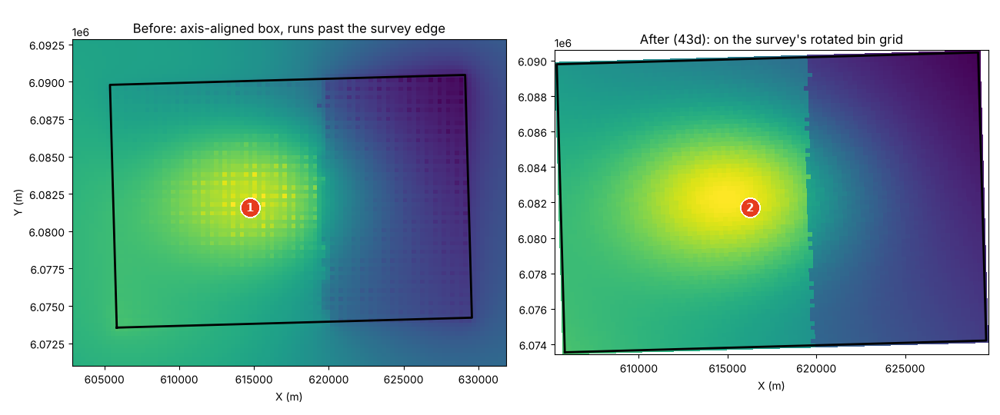

*Live grid before / after fix 43d - the Live grid of FS6 built by the Live Map code (livegrid.LiveGridder) both ways on the F3-like test survey. The window itself could not be drawn where this tutorial was built (no Qt on the build server); Install GeoHarmonic.bat rebuilds this page with the real window.*

1. Old grid: square box padded 10 %, outside the outline
2. New grid: exactly inside the outline (black)

### How it works

1. Double-click **Update_GeoHarmonic.bat** on the Desktop, then **Install GeoHarmonic.bat** (re-runs every test and rebuilds this tutorial on your F3 project).
2. Wait for **ALL GOOD**. In `tools\Seismic Interpretation Tool\test_results.txt` search for `43a` ... `43g`: every line must say PASS.
3. Seismic tool: **Interpret > Survey horizon blending (adaptive seam, overlapping surveys)...** opens.
4. F3: **View > Live Map** > **Live grid...** > *Horizon: FS6*: the grid fills the outline exactly.
5. Live Map **Arbitrary line**: three clicks + double-click -> the section window opens.

### Results

The regression checks on the build server (Qt mock; the window parts run against real Qt on your PC):

| Test output | PASS | FAIL | Verdict |
|---|---|---|---|
| seismic_selftest | 1235 | 0 | SELFTEST PASSED |
| seismic_guitest | 466 | 0 | GUI TEST PASSED |
| wellcorr_selftest | 198 | 0 | SELFTEST PASSED |

```
PASS 43a: no dialog / window attribute shadows a QWidget / QDialog method
PASS 43a: survey blending 'Show' combo renamed show_combo
PASS 43b: lin_index keeps k <= n - 2 and w in [0, 1] (float32)
PASS 43b: lin_index keeps k <= n - 2 and w in [0, 1] (float64)
PASS 43b: Wheeler level exactly at the last sample interpolates (no IndexError; float32)
PASS 43b: a level beyond the last sample gives no amplitude (NaN)
PASS 43b: Wheeler level exactly at the last sample interpolates (no IndexError; float64)
PASS 43b: RGT interp_rows at the last sample / beyond is clamped, not out of bounds
```
*8 of 41 matching test checks shown.*

### Known limits

- The build server has no Qt / graphics card: the real-Qt parts of 43a / 43e (open every window, double-click) run on your PC in the installer's GUI test.

### Troubleshooting

- If a 43 line says FAIL on your PC, send `test_results.txt` to Claude.

<a id="f3_intro"></a>

## Part 1 - Worked example: F3 Netherlands, start to finish

F3 is dGB's public North Sea block (Dutch sector): a 3D volume *F3 original*, four wells (F02-1, F03-2, F03-4,
F06-1) with logs, checkshots and markers, seven interpreted horizons (Shallow, Truncation, FS8, FS7, FS6, FS4, MFS4)
and Fault A. **Set up F3 project.bat** builds the GeoHarmonic project in `Documents\F3 Netherlands`. The chapters
below follow one interpretation from opening the project to prospects; each one says what the step is for (and what
it replaces in Kingdom / Petrel), the clicks, the result with the numbers this build got, and what to look for.

<a id="f3_open"></a>

## W1. Open F3 and look around

**What it is for.** Like opening a Kingdom project or a Petrel survey: the 3D volume, the interpreted horizons, Fault A and the four wells, all in one place.

### How it looks

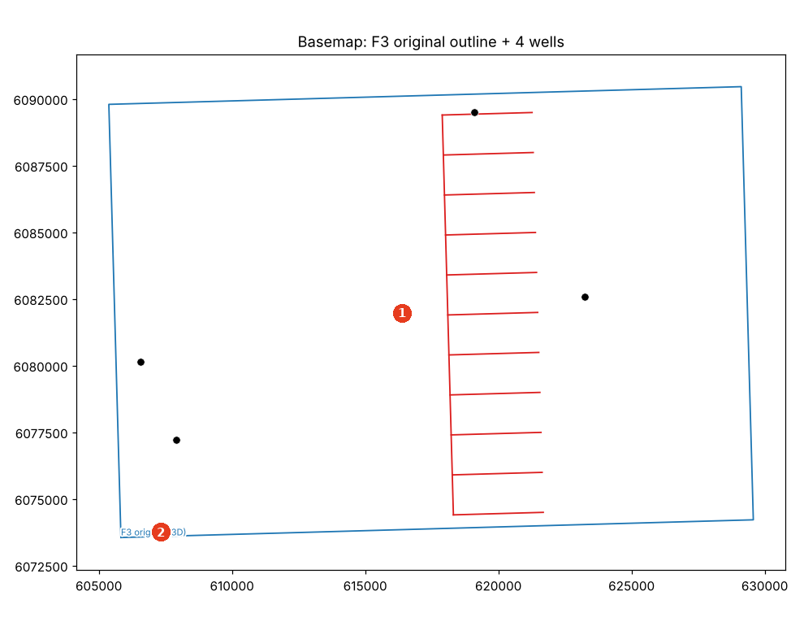

*Basemap of the project - the synthetic F3-like test project (same names and survey frame as F3; your F3 project was not found), drawn by the program's own export.*

1. 3D survey outline (rotated F3 bin grid)
2. Wells with names

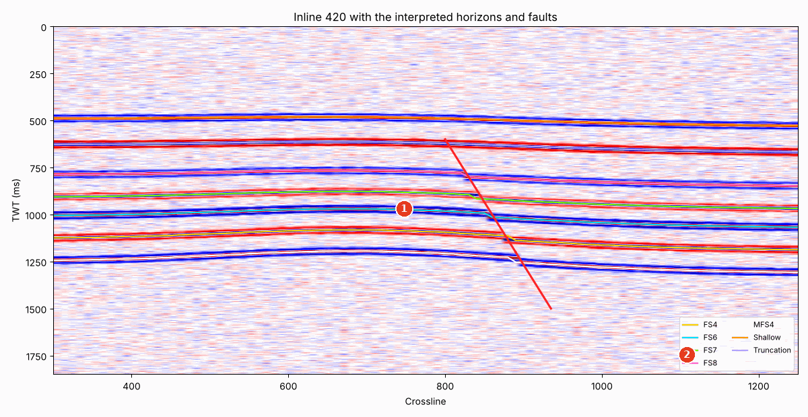

*Inline 420 - the synthetic F3-like test project (same names and survey frame as F3; your F3 project was not found), drawn by the program's own export.*

1. Seismic, TWT down
2. Horizons (legend)

### How it works

1. Double-click **GeoHarmonic - Seismic Interpretation** on the Desktop.
2. **File > Open project...** (**Ctrl+O**) > `Documents\F3 Netherlands\F3 Netherlands.seisproj.json`.
3. In the **Data** panel double-click **F3 original**; type **420** in the inline box and press Enter.
4. Page through with **PgDown / PgUp**; switch **Inline / Crossline / Time slice** on the toolbar.
5. The **Basemap** panel shows the survey outline and the wells; click inside the outline to jump to that inline.

### Results

Volume **F3 original**: inlines 100-750, crosslines 300-1250, 463 samples at 4 ms (0-1848 ms). Outline X 605,376-629,571 m, Y 6,073,549-6,090,456 m (ED50 / UTM 31N). 7 horizons (FS4, FS6, FS7, FS8, MFS4, Shallow, Truncation); 4 wells (F02-1, F03-2, F03-4, F06-1); faults: Fault A.

### What to look for

- Horizons sit on their reflectors along the whole inline.
- Wells plot inside the outline.

<a id="f3_wells"></a>

## W2. Well correlation of the four wells

**What it is for.** The Well Correlation Tool is the Petrel well-section / Kingdom cross-section window: logs side by side, hung on TVDSS or flattened on a top, tops correlated between wells.

### How it looks

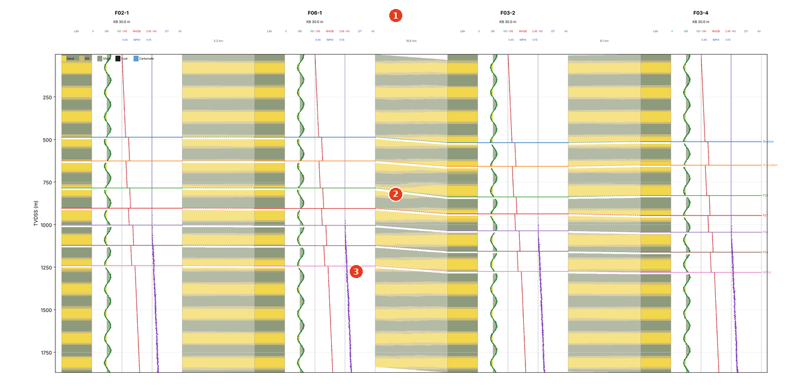

*Well section 'F3 wells W-E' - the synthetic F3-like test project (same names and survey frame as F3; your F3 project was not found), drawn by the program's own export.*

1. Well names + track headers
2. GR / DT / density tracks
3. F3 markers correlated between the wells

### How it works

1. Double-click **GeoHarmonic - Well Correlation**; **File > Open project...** > `F3 Netherlands.wcproj.json`.
2. The section **F3 wells W-E** opens: F02-1, F06-1, F03-2, F03-4.
3. Hang on **TVDSS**, then **View > Flatten on** FS6 to check the correlation.
4. Drag a top to move it; **Ctrl+Z** undoes. The seismic tool and the Live Map follow (map bus).

### Results

7 formations, 28 tops in the section. FS6 MD: F02-1 1033 m, F06-1 1034 m, F03-2 1066 m, F03-4 1074 m.

### What to look for

- Each marker lines up with a log break (GR / density).
- Flattened on FS6 the shallower markers stay roughly parallel.

<a id="f3_ties"></a>

## W3. Well ties

**What it is for.** Synthetic seismogram and bulk / stretch tie (Kingdom SynPAK, Petrel Well tie, HRS).

### How it looks

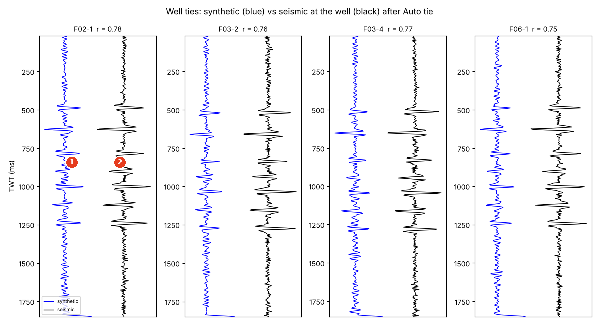

*Well ties of the four wells - the synthetic F3-like test project (same names and survey frame as F3; your F3 project was not found), drawn by the program's own export.*

1. Synthetic seismogram (blue)
2. Seismic trace at the well (black)

### How it works

1. Seismic tool: **Interpret > Well tie (synthetic seismogram)...**.
2. Pick the well, wavelet **Ricker 30 Hz**, press **Compute**, then **Auto tie**.
3. Check the correlation, then **Save** - the tie is stored in the project and every window uses it.

### Results

F02-1: shift +1.7 ms, correlation 0.78; F03-2: shift +2.4 ms, correlation 0.76; F03-4: shift +2.8 ms, correlation 0.77; F06-1: shift +2.2 ms, correlation 0.75. Best correlation 0.78.

### What to look for

- Synthetic and seismic peaks line up after Auto tie.
- Shift of a few ms; a large shift means a wrong checkshot or datum.

<a id="f3_cond"></a>

## W4. Seismic conditioning (Interpretation preset)

**What it is for.** Structure-oriented filtering and noise removal before picking - like Petrel's structural smoothing or Kingdom's filters, with a protect zone that stays untouched.

### How it looks

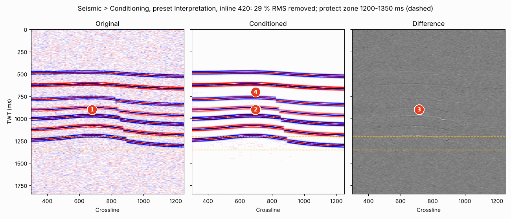

*Conditioning preview - the synthetic F3-like test project (same names and survey frame as F3; your F3 project was not found), drawn by the program's own export.*

1. Original
2. Conditioned
3. Difference = what was removed
4. Protect zone (not filtered)

### How it works

1. Show inline **420**.
2. **Seismic > Conditioning (spikes, bandpass, FX decon, SOF, footprint)...**.
3. Preset **Interpretation** (chain: spikes > bandpass > fxdecon > sof > footprint).
4. **Add protect zone...**: whole survey, **1200-1350 ms**.
5. **Preview** > original | conditioned | difference; **Run on volume** writes a new volume.

### Results

29 % of the RMS removed on inline 420; signal-leakage score 0.19 (low = only noise removed).

### What to look for

- The difference panel shows noise, not reflectors.
- Inside the protect zone the difference is zero.

<a id="f3_pick"></a>

## W5. Horizon / fault picking and autotracking

**What it is for.** Seed picks and the wavefront autotracker (Kingdom's Hunt, Petrel's seeded 3D autotracking); Fault A stops the tracker.

### How it looks

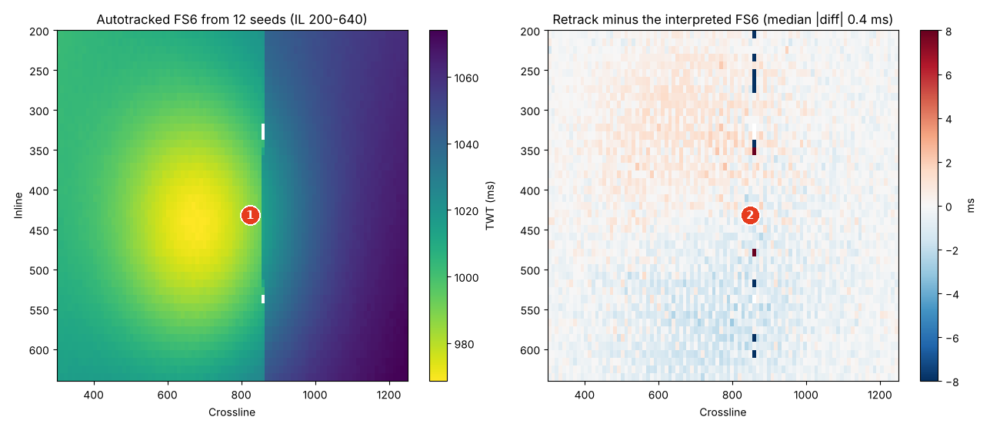

*Autotracking from seeds - the synthetic F3-like test project (same names and survey frame as F3; your F3 project was not found), drawn by the program's own export.*

1. Tracked horizon (time)
2. Difference to the interpreted horizon

### How it works

1. Horizons panel **New**, name it; press **P** (pick mode).
2. Click the FS6 reflector on inline 420 a few times, then **T** (**Interpret > Track horizon from seeds**).
3. Faults: **N**, click down the fault, **Enter** ends the stick.
4. **Ctrl+Z** undoes the last edit.

### Results

12 seeds on inline 420; tracked 100% of inlines 200-640 in 0.1 s; median difference to the interpreted FS6: 0.4 ms.

### What to look for

- The tracked surface stops at Fault A instead of jumping across.

<a id="f3_faults"></a>

## W6. Automated fault mapping

**What it is for.** Fault likelihood + fault skins (PaleoScan AFE, Petrel Fault extraction).

### How it looks

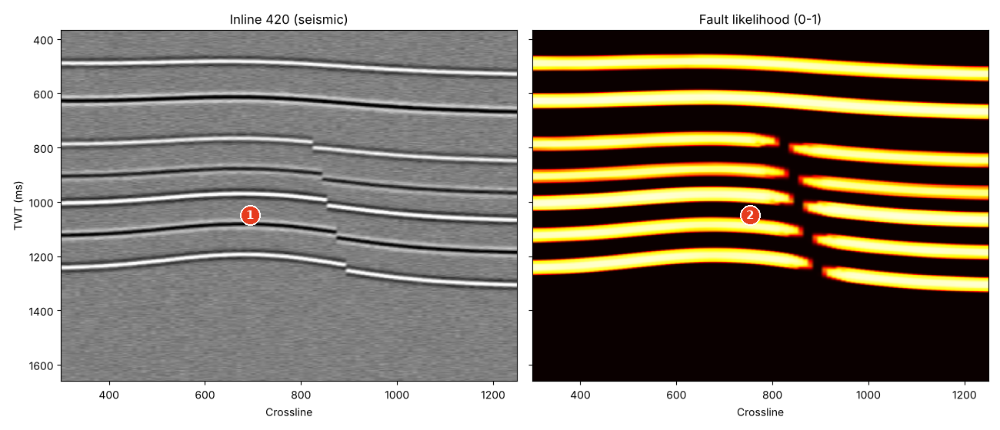

*Automated fault mapping - fault likelihood - the synthetic F3-like test project (same names and survey frame as F3; your F3 project was not found), drawn by the program's own export.*

1. Input inline
2. Fault likelihood: dark = likely fault

### How it works

1. **Interpret > Automated fault mapping (fault likelihood, auto faults, polygons)...**.
2. Compute on a box first (IL 360-480, 96 crosslines, 368-1660 ms), check thresholds, then the whole volume.
3. **Extract** skins, filter by strike / dip, **Create faults** (sticks every 5 lines), **Polygons** for the map.

### Results

Box IL 360-480, 96 crosslines, 368-1660 ms: 3.2 s; median likelihood 1.00. Along the interpreted Fault A (around crossline 856) the likelihood maximum is 656 m from the fault on average.

### What to look for

- A sharp dark line along Fault A; noise stays light grey.

<a id="f3_rgt"></a>

## W7. RGT and Wheeler diagram

**What it is for.** Relative geologic time, horizon stack and Wheeler diagram (PaleoScan, Petrel Geobody/Stratal slicing).

### How it looks

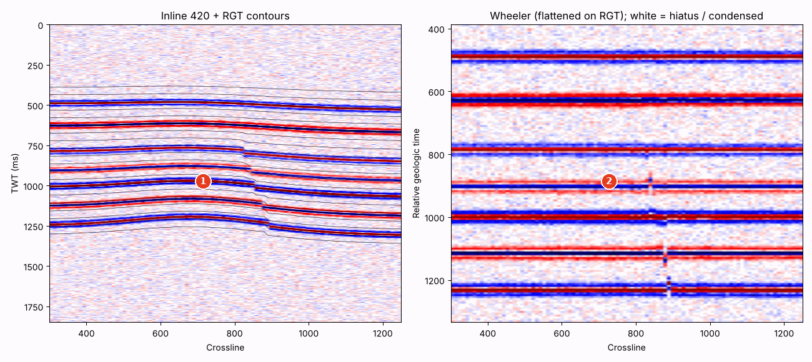

*RGT contours and Wheeler diagram - the synthetic F3-like test project (same names and survey frame as F3; your F3 project was not found), drawn by the program's own export.*

1. RGT contours follow the reflectors
2. Wheeler: every level flat

### How it works

1. **Interpret > Compute RGT (current 3D volume)...** (on F3 about 10-20 min; the tutorial uses the interpreted horizons as RGT control on one inline to stay quick).
2. **Interpret > Build horizon stack (3D)...**.
3. Section toolbar domain **Wheeler**: every level is flat; **Stratal slice** mode for maps.

### Results

160 levels between Shallow, Truncation, FS8, FS7, FS6, FS4, MFS4; 0.0% of the Wheeler cells flagged as hiatus / condensed.

### What to look for

- RGT contours follow the reflectors
- Gaps (white) where intervals thin out.

<a id="f3_depth"></a>

## W8. Velocity model and depth conversion

**What it is for.** Layer-cake velocity model tied to the well tops (Kingdom Dynamic Depth Conversion, Petrel velocity modelling); the velocity volume is the advanced mode.

### How it looks

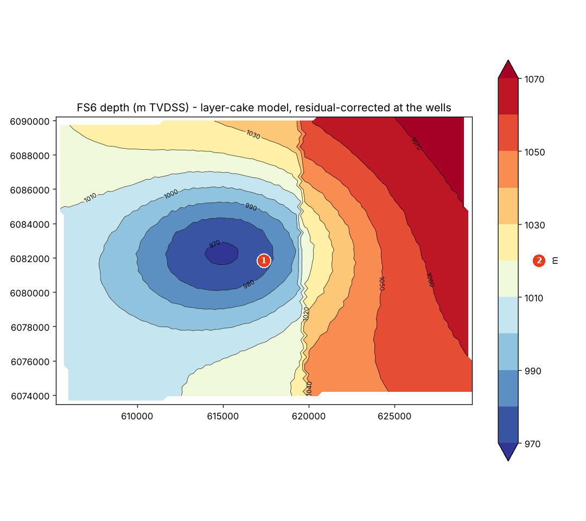

*FS6 depth map - the synthetic F3-like test project (same names and survey frame as F3; your F3 project was not found), drawn by the program's own export.*

1. Depth map with contours
2. Colour bar (m)

### How it works

1. **Interpret > Velocity model + depth conversion...**.
2. Layers: Truncation = Truncation, FS8 = FS8, FS6 = FS6, MFS4 = MFS4; function V0 per layer; tick **Residual correction**; **Build**.
3. **Show depth map**; **Use** makes it the depth model of every window (section domain **Depth**).
4. Advanced: **Interpret > Velocity volume depth conversion (advanced)...** > Build > Blind test.

### Results

Built in 0.0 s on 4 wells; largest misfit at the wells after residual correction 0.00 m. FS6 depth 969-1077 m TVDSS.

### What to look for

- Misfit at the wells ~0 m with residual correction on.
- No bull's-eyes around the wells.

<a id="f3_map"></a>

## W9. Live Map: Live grid, styling, filters, selection, arbitrary line, export

**What it is for.** Kingdom-style live base map with Spotfire-style well styling, shared selection with every window.

### How it looks

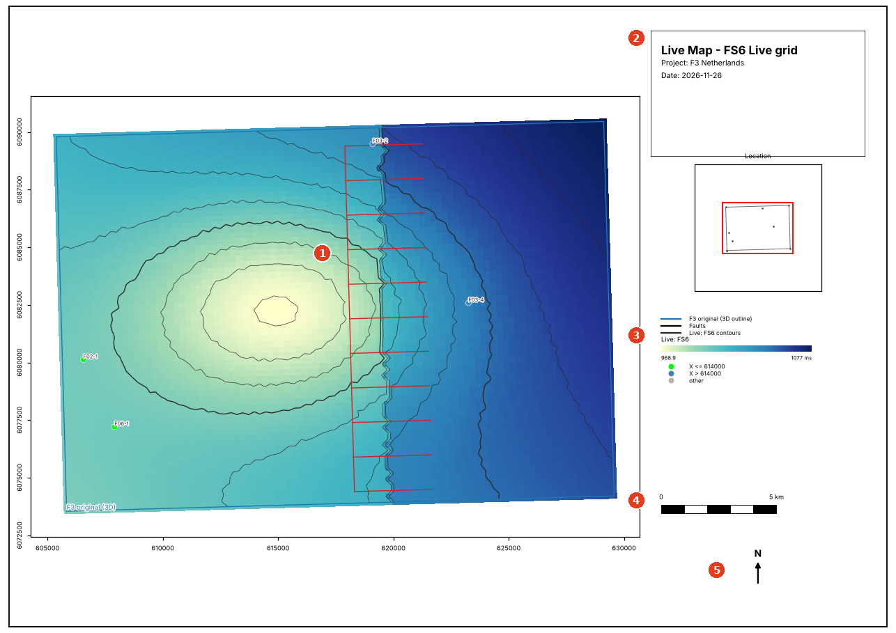

*Live Map export - the synthetic F3-like test project (same names and survey frame as F3; your F3 project was not found), drawn by the program's own export.*

1. Live grid FS6 (inside the survey outline)
2. Title block
3. Legend: one row per rule + other
4. Scale bar
5. North arrow

### How it works

1. **View > Live Map** (**Ctrl+Shift+M**).
2. **Live grid...** > *Horizon: FS6* - gridded on the survey's own bins (rotated), coarse while picking, full on pause.
3. Colour by **rules**: `X <= 614000 = lime; X > 614000 = steelblue` > **Apply**.
4. Add a filter on X; drag the range.
5. Lasso wells; the seismic basemap and the Well tool select them too.
6. **Arbitrary line**: click points, **double-click** (or **Enter** / right-click) - the section opens; **Esc** cancels.
7. **Export map (PNG / PDF)...**.

### Results

Live grid FS6: 66 x 96 nodes in 0.0 s, X 605,376-629,571 m = the outline (X 605,376-629,571 m). 4 of 4 wells shown after the filter.

### What to look for

- The grid sits exactly inside the outline (fix 43d).
- Legend has one row per rule + other.
- Wells hidden by a filter have no labels.

<a id="f3_look"></a>

## W10. Glow, halo and aesthetics

**What it is for.** Display polish: glowing interpretation, hillshade, themes and figure export.

### How it looks


*Glow on horizons and faults - the synthetic F3-like test project (same names and survey frame as F3; your F3 project was not found), drawn by the program's own export.*

1. Horizons and Fault A with a glow

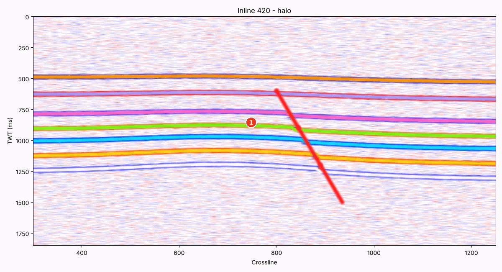

*Halo on horizons and faults - the synthetic F3-like test project (same names and survey frame as F3; your F3 project was not found), drawn by the program's own export.*

1. Horizons and Fault A with a halo

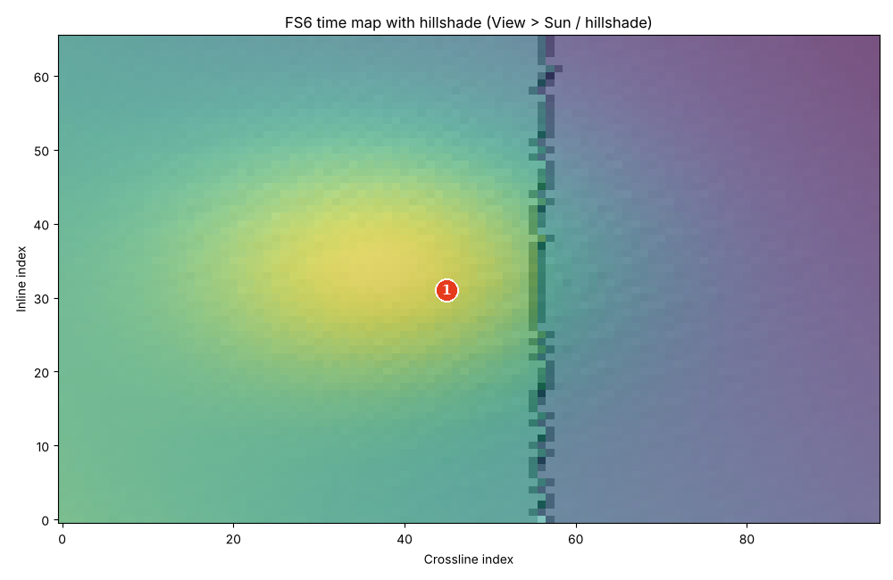

*FS6 hillshade - the synthetic F3-like test project (same names and survey frame as F3; your F3 project was not found), drawn by the program's own export.*

1. Hillshade brings out the dome and Fault A

### How it works

1. **Display > Glow mode: Glow** (or **G**), **Display > Glow mode: Halo**.
2. **View > Theme > Dark / Light**.
3. **File > Export section figure (title block, scale bar, legend)...**.

### Results

13 glowing curves drawn on inline 420.

### What to look for

- Thin horizons stay readable on busy seismic.

<a id="f3_3d"></a>

## W11. 3D Viewer and 3D interpretation

**What it is for.** Petrel-style 3D window: planes, horizons, faults, wells; volume rendering and geobodies.

### How it looks

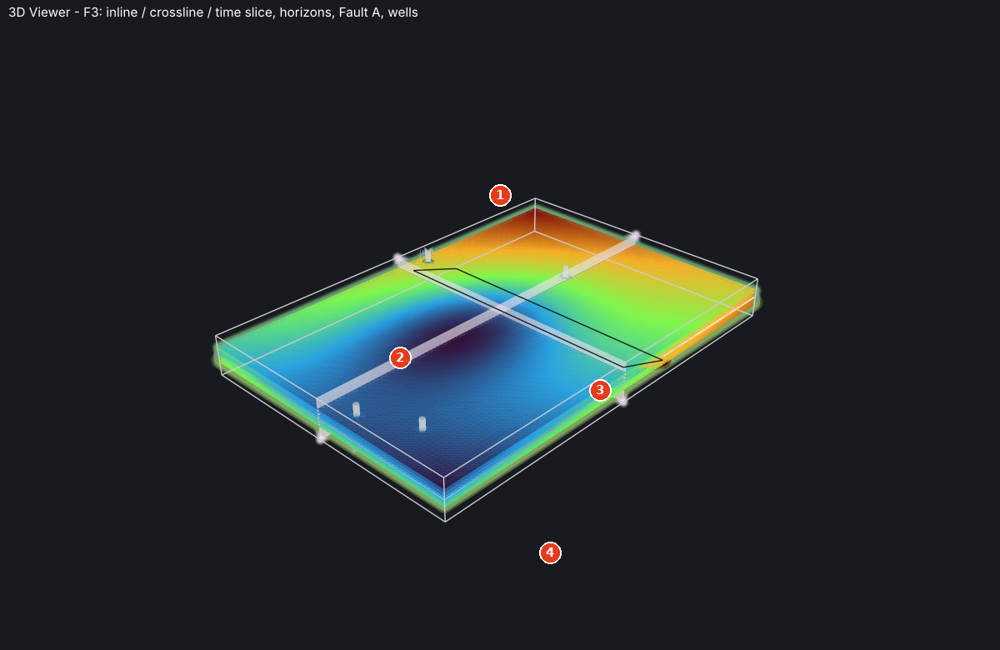

*3D Viewer (software renderer) - the synthetic F3-like test project (same names and survey frame as F3; your F3 project was not found), drawn by the program's own export.*

1. Inline / crossline planes
2. Horizons
3. Fault A
4. Wells

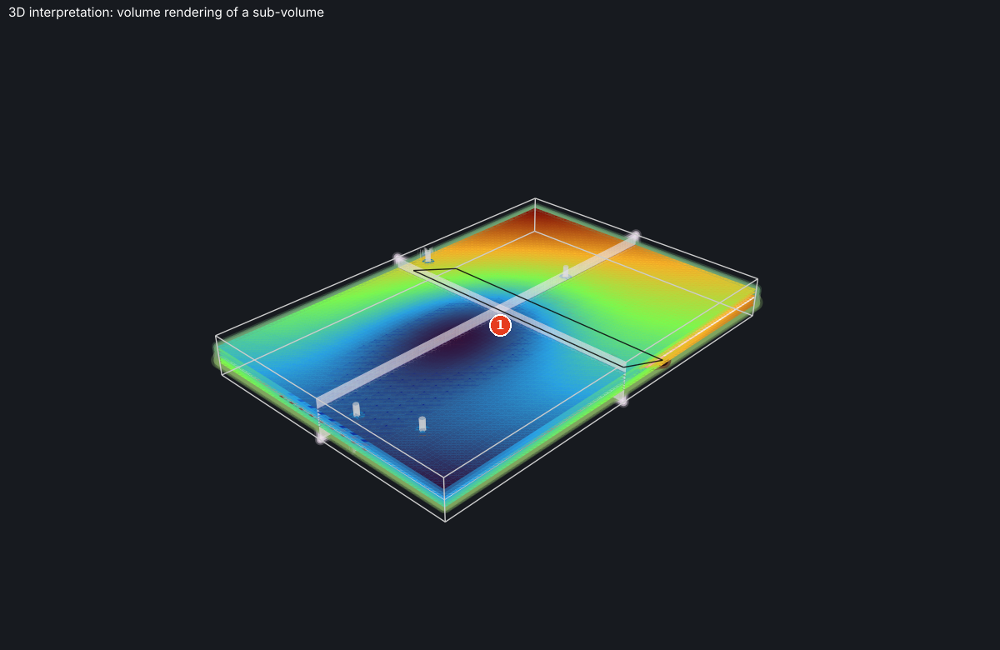

*3D interpretation - the synthetic F3-like test project (same names and survey frame as F3; your F3 project was not found), drawn by the program's own export.*

1. Volume-rendered sub-volume (opacity slabs)

### How it works

1. **View > 3D Viewer (slices, horizons, faults, wells)...** (**Ctrl+Shift+3**).
2. Drag the plane sliders; left-drag orbits, wheel zooms.
3. Toolbar **Volume render** on a box; **Geobodies** with a threshold.

### Results

Volume rendering of IL 280-570, 552-1384 ms: 9 slabs (read stride 3); 21 bodies of 20+ cells above the 99th-percentile amplitude (0.84) in that box; 1.8 s.

### What to look for

- Planes, horizons and Fault A line up in 3D.

<a id="f3_frame"></a>

## W12. Structural framework and 3D grid

**What it is for.** Fault-block framework and a stair-stepped corner-point grid (Petrel Structural framework / Pillar gridding) exported as GRDECL.

### How it looks

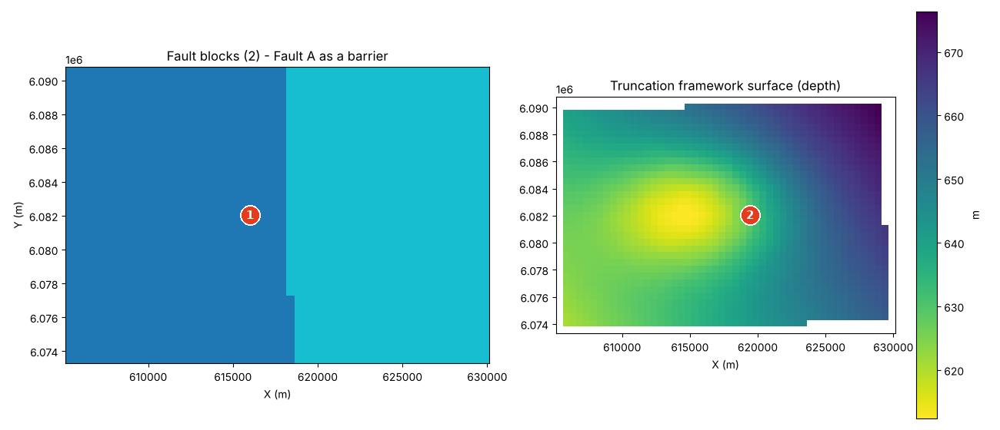

*Structural framework - the synthetic F3-like test project (same names and survey frame as F3; your F3 project was not found), drawn by the program's own export.*

1. Fault blocks
2. Framework surface per block

### How it works

1. **Interpret > Structural framework + 3D grid (GRDECL)...**.
2. **1. Framework (time)**, **2. Depth (current depth model)**, **3. 3D grid**, **Export GRDECL...**.

### Results

Horizons Truncation, FS8, FS6, MFS4: 2 fault blocks; grid 9996 cells (8736 active, negative thickness 0) in depth; 1.6 s.

### What to look for

- Two blocks either side of Fault A.
- No negative-thickness cells.

<a id="f3_props"></a>

## W13. Property modelling and volumetrics

**What it is for.** Properties in the 3D grid and volumetrics per zone and block (Petrel Property modelling).

### How it looks

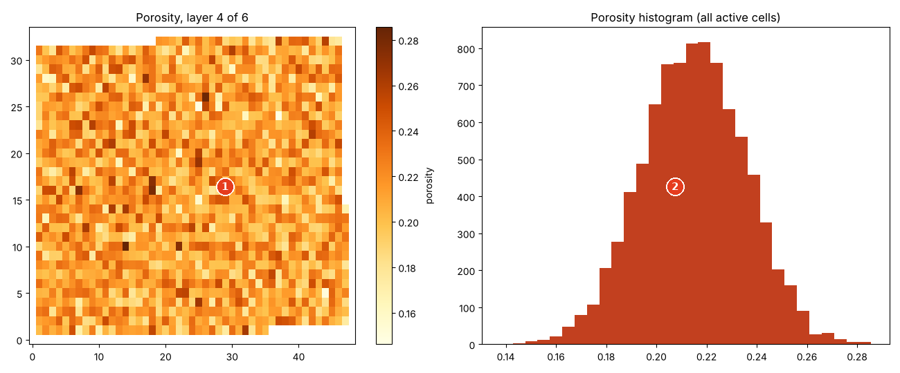

*Property model - the synthetic F3-like test project (same names and survey frame as F3; your F3 project was not found), drawn by the program's own export.*

1. Property in the 3D grid
2. Distribution

### How it works

1. In the framework dialog **4. Properties + volumetrics...**.
2. **Upscale logs**, **Variogram**, **Simulate** (SGS), **Volumetrics** with the contacts, **Export**.

### Results

8736 active cells; mean porosity 0.215. Zone FS6-MFS4 with an OWC at 1038 m (placed so 3 % of the zone's cells are above it - an illustration, not an F3 contact): STOIIP 1367.4 MMbbl.

### What to look for

- Porosity follows the layering; no values in inactive cells.

<a id="f3_prospects"></a>

## W14. Prospects, migration and spacing

**What it is for.** Fill-spill migration on the depth map, Rose-style volumetrics, drainage ellipses.

### How it looks

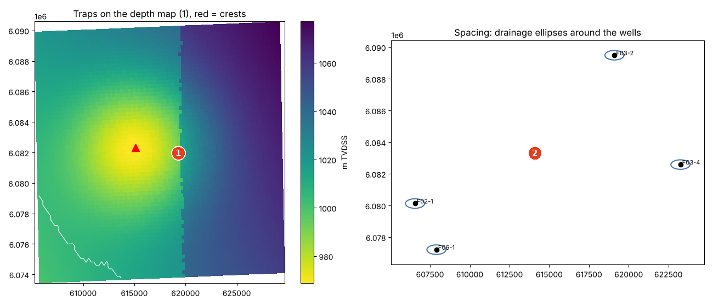

*Prospects, migration and spacing - the synthetic F3-like test project (same names and survey frame as F3; your F3 project was not found), drawn by the program's own export.*

1. Migration traps (fill-spill)
2. Drainage ellipses

### How it works

1. **Map layers > Add... > Migration: flow paths, traps, fill-spill on the selected depth grid**.
2. **Map layers > Add... > DHI checklist...** stores a prospect (risk + volumetrics).
3. Dashboard: **Spacing + ellipses...**.

### Results

1 traps; largest: crest 969 m, spill 1003 m (column 35 m); P50 recoverable 2.06 million bbl (illustrative parameters).

### What to look for

- Traps sit on the closures of the depth map.

<a id="wellcorr"></a>

## 3. Well Correlation (+ petrophysics window)

**What it is for.** The well-log correlation and tops tool - think Kingdom's cross-section / log correlation window or Petrel's Well
Section, plus a Geolog / IP-style petrophysics window. You pick formation tops on a flattened or structural
section, let the tool suggest tops in the other wells, and compute Vsh, porosity, Sw and net pay.

### How it looks

*Well Correlation main window (bundled NZ wells) - not captured (no Qt on the build server - the window cannot be drawn here). Install GeoHarmonic.bat rebuilds the tutorial on your PC with a real screenshot.*


*Correlation section export - the Well Correlation Tool's own section export (File > Export section image) on the bundled NZ wells. The window itself could not be drawn where this tutorial was built (no Qt on the build server); Install GeoHarmonic.bat rebuilds this page with the real window.*

1. Well name, datum and track headers
2. Lithology column
3. Log tracks (GR, resistivity, density / neutron, sonic)
4. Formation tops correlated between the wells

*Petrophysics window - not captured (no Qt on the build server - the window cannot be drawn here). Install GeoHarmonic.bat rebuilds the tutorial on your PC with a real screenshot.*

### How it works

1. Start **GeoHarmonic - Well Correlation**. **File > New project from data folder...** (**Ctrl+N**) and pick the folder with your LAS files (one sub-folder per well works too), or **File > Open project...** (**Ctrl+O**). The F3 set-up makes `Documents\F3 Netherlands\F3 wells` for you.
2. Click wells on the map (left) to put them on the section; drag them to reorder.
3. **Edit > Pick tops** (**P**), choose the formation, click on a log track to place the top. **Ctrl+Z** / **Ctrl+Y** undo / redo.
4. **Correlate > Suggest active top in selected well** (**S**) or *in all section wells missing it* (**Shift+S**); accept with **Enter**, reject with **Esc**. **G** shows a ghost curve at the cursor.
5. **Correlate > Zone statistics...** (**Z**) for averages per zone; **Correlate > Compare tops with reference...** (**R**) to check against a published tops list.
6. **Petrophysics > Petrophysics window...** (**Ctrl+Shift+P**): curve QC, Vsh, porosity, Sw (Archie / Simandoux / Indonesia), multimineral solve, Monte-Carlo uncertainty, net-pay cut-offs, rock physics.
7. **File > Export section image (PNG/PDF)...** (**Ctrl+E**); **File > Export tops > Kingdom tops** or *OpendTect well markers* for the other packages. **Ctrl+S** saves.

### Results

A section with your tops, correlation fill between wells and the petrophysics tracks. The self-test proves the
LAS / DLIS reading, top suggestion and petrophysics against hand-computed answers:

```
PASS Tui-1 TD from DLIS checkshot (3875 m TVDSS -> 2806 ms)
PASS 27c: top seal Vsh 0.6 -> 10 bar -> 131 m; thin seal holds nothing
PASS suggest pick finds the sand top (1540.1 vs 1540.0)
PASS DLIS: frame with 120 rows reassembled from multi-segment records
PASS DLIS: array channel (dimension 6)
PASS DLIS -> LAS 2.0 (depth in m, absent -> NULL, array channel skipped) reads back with the LAS reader
PASS Tui-1 DLIS parsed in 0.8 s
PASS Archie Sw = 0.25 (hand value)
```
*8 of 17 matching test checks shown.*

### Known limits

- Deviated wells are drawn along MD in the section (TVD shading in the petro window).

### Troubleshooting

- *Logs look flat / missing*: **File > Reload logs (rebuild cache)**.
- A well with no logs is listed by the self-test check `--check <folder>` in the README.

<a id="mistie"></a>

## 4. Mistie analysis (2D-2D, 2D-3D)

**What it is for.** Measures and solves the time, phase and gain misties between 2D lines and 3D surveys - the equivalent of Kingdom's
Mistie Analysis / Petrel's Seismic Well Tie mistie tools. There are two ways in: the stand-alone **GeoHarmonic -
Mistie** tool (for the NPRA-style 2D line sets) and **Interpret > Mistie analysis (2D-3D, 2D-2D)...** inside the
Seismic tool.

### How it looks

*Mistie analysis dialog - not captured (no Qt on the build server - the window cannot be drawn here). Install GeoHarmonic.bat rebuilds the tutorial on your PC with a real screenshot.*

### How it works

1. Seismic tool: load your 2D lines (**File > Add 2D SEG-Y lines...**, **Ctrl+2**) and the 3D (**File > Import 3D SEG-Y...**, **Ctrl+3**).
2. **Interpret > Mistie analysis (2D-3D, 2D-2D)...** finds every line crossing and measures shift, phase and gain by cross-correlation in the window you set.
3. Tick **Robust (down-weight ties that disagree with the network)** so one bad tie cannot pull the network; hold a key line fixed. Options: **Flex mode**, **Tie overlapping / duplicate lines along the overlap**, **Time-variant shift for lines crossing a 3D**.
4. Apply the solution; the corrected lines are used everywhere (sections, tracking, maps). The misties are drawn on the Live Map as coloured markers.
5. Stand-alone tool: double-click **GeoHarmonic - Mistie**, open the config JSON (e.g. `examples_npra_config.json`), *Run*. Its tie table can be linked into the Seismic tool.

### Results

The tests build lines with known misties and recover them:

```
PASS mistie measure: shift 8.89 ms, phase 33.7 deg, gain 2.00 (true 9, 35, 2)
PASS 2D-3D tie: 8.01 ms / 30.2 deg / x2.00 (true 8.0, 30.0, 2.0), corr 1.00
PASS robust (Huber) solve isolates the bad tie (residual +28.2 ms)
PASS horizon-based misties (2D-3D and 2D-2D)
PASS time-variant mistie: 310 ms: 4.3, 428 ms: 5.8, 550 ms: 7.1, 728 ms: 8.8, 838 ms: 9.6, 908 ms: 10.1
PASS time-variant correction applied (corr with 3D 0.99)
PASS mistie measure with max lag > window (+5.76 ms, |6|)
PASS 31e: mistie residual markers green / orange / red
```
*8 of 17 matching test checks shown.*

### Known limits

- Time-variant mistie only for 2D lines that cross a 3D.

### Troubleshooting

- *No ties found*: the 2D navigation must be in the same coordinate system as the 3D (**File > Add 2D navigation CSV...**).

<a id="seismic"></a>

## 5. Seismic viewer, horizon + fault picking, autotracking

**What it is for.** The main interpretation window - Kingdom's Vertical Seismic View + Map View in one. Inline / crossline / time slice
/ 2D line display, horizon picking with seeded autotracking, fault sticks, attributes, co-blending and wells on
the section.

### How it looks

*Seismic Interpretation main window - not captured (no Qt on the build server - the window cannot be drawn here). Install GeoHarmonic.bat rebuilds the tutorial on your PC with a real screenshot.*

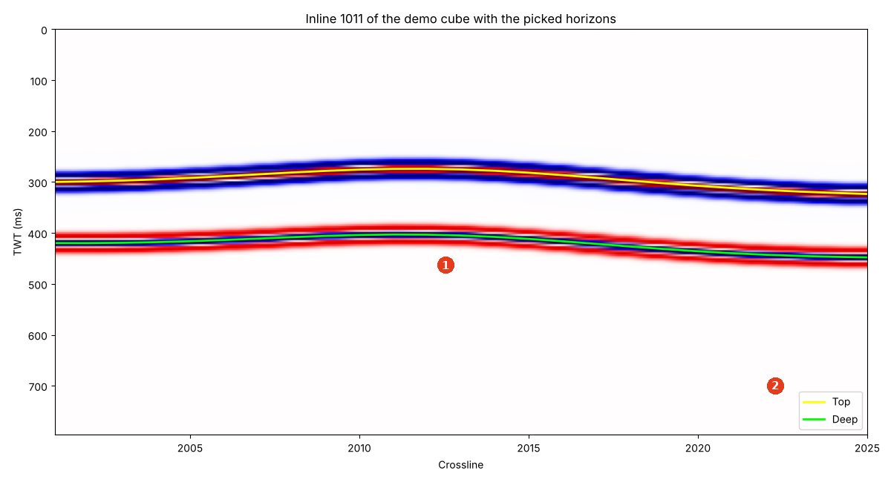

*Inline with picked horizons - plotted by the tutorial builder from the demo project's volume and horizons (not a window). The window itself could not be drawn where this tutorial was built (no Qt on the build server); Install GeoHarmonic.bat rebuilds this page with the real window.*

1. Seismic (red-white-blue), TWT down
2. Horizons Top / Deep (picked)

### How it works

1. Start **GeoHarmonic - Seismic Interpretation**. **File > New project...** (**Ctrl+N**), then **File > Import 3D SEG-Y...** (**Ctrl+3**) and/or **File > Add 2D SEG-Y lines...** (**Ctrl+2**). Big files are read from disk on demand (no full load).
2. Pick the line in the toolbar (Inline / Crossline / Time slice and its number). **PgDown / PgUp** step to the next / previous line.
3. Horizons panel: **New** (or **Interpret > New horizon...**), then **Pick mode (P)** and click seeds on the reflector.
4. **Track (T)** (**Interpret > Track horizon from seeds**) autotracks peak / trough / zero crossing from your seeds across the 3D and onto crossing 2D lines; it stops at faults. **Ctrl+Z** undoes the last edit or tracking run.
5. Faults panel: **New (N)**, **Fault mode (F)**, click points of a stick, **End stick (Enter)**.
6. **File > Link well project...** shows the Well tool's wells, logs and tops on the section.
7. **View > Co-blend attributes on the section (RGB / CMY / HSV)...**, **View > Attribute overlay...** and **View > Bump-map the section / slice** for SeisWare-style displays. **Ctrl+S** saves.

### Results

The tracker is tested on folded, noisy and faulted synthetic data:

```
PASS 3D autotrack covers the survey (3499 picks)
PASS 3D autotrack recovers folded reflector (max 1.45 ms, mean 0.22 ms, dt 4 ms)
PASS no tracking through incoherent noise with min corr 0.95 (0 picks)
PASS lateral mix 7 tracks noisy data better (correct picks 7 -> 200 of 200)
PASS without faults the tracker crosses the fault (100% of hanging wall)
PASS with the fault the tracker stays in the footwall (99% footwall, 0% hanging wall)
```
*6 of 6 matching test checks shown.*

### Known limits

- Tracking from the 3D window is described in chapter 15; both write the same horizon.

### Troubleshooting

- *Tracking runs through noise*: raise **Min correlation** in the Horizons panel; set **Lateral mix 2D** to 5-9 traces for noisy land 2D; keep **Tracker stops at faults** ticked.

<a id="rgt"></a>

## 6. RGT, horizon stack, Wheeler, stratal slices

**What it is for.** PaleoScan-style relative geologic time: a dip field, a global RGT solve, then hundreds of iso-RGT horizons (the
horizon stack), a Wheeler (chronostratigraphic) display and stratal slices.

### How it looks


*RGT contours and Wheeler diagram - the synthetic F3-like test project (same names and survey frame as F3; your F3 project was not found), drawn by the program's own export.*

1. RGT contours follow the reflectors
2. Wheeler: every level flat

### How it works

1. **Interpret > Compute dip field (current 3D volume)...**.
2. **Interpret > Compute RGT (current 3D volume)...** (or *all 2D lines*). Optional constraints: **Interpret > Use active horizon as RGT constraint**, **Well seeds from tied tops**.
3. **Interpret > Build horizon stack (3D)...**; browse the levels on the section; **Interpret > Convert stack level to horizon...** keeps one as a normal horizon.
4. Fix the model where needed: **Interpret > RGT edit mode on/off** (**E**) - click a level, then click where it belongs; **Re-link RGT around active fault** for cross-fault links.
5. Wheeler: set the section's domain box to **Wheeler** (vertical axis = relative geologic time, gaps = hiatus) or **Wheeler (age)** (Ma, from the Basin model age table); tick **RGT contours** to draw the stack levels.

### Results

RGT accuracy on synthetic geology with a fault and a pinch-out:

```
PASS RGT solved {'unknowns': 26576, 'equations': 105043, 'iterations': 879, 'seconds': 3.05, 'coarse_start': False}
PASS iso-RGT surfaces match 60 true horizons: median 0.15 ms, 97% with p95 < 1 sample (pinch-out zone excluded)
PASS with a fault: iso-RGT surfaces match across the fault above the wedge (p95 max 3.5 ms), median 0.22 ms overall
PASS Wheeler: amplitude is constant along each RGT level (98% of the variance is between levels)
PASS moved level: RGT at the new position = grabbed value (local solve 7399 unknowns, 0.35 s)
PASS fault re-link: p95 error above the wedge 29.3 -> 0.6 ms
PASS Wheeler %Ro: the 30 Ma row == %Ro at surface B; %Ro increases with age
PASS Wheeler at 30 Ma: younger sediment not yet deposited (blank)
```
*8 of 13 matching test checks shown.*

### Known limits

- The RGT is stored as uint16 per sample (precision about 1/65,000 of the time range).

### Troubleshooting

- *Levels jump across a fault*: pick the fault first, then **Re-link RGT around active fault**.

<a id="welltie"></a>

## 7. Well tie (synthetic seismogram)

**What it is for.** Hampson-Russell-style well tie: synthetic from sonic + density, auto-correlate (bulk shift + stretch), constrained
stretch / squeeze (DTW), wavelet estimation, drift QC against the checkshot, and multi-well batch ties.

### How it looks

*Well tie dialog - not captured (no Qt on the build server - the window cannot be drawn here). Install GeoHarmonic.bat rebuilds the tutorial on your PC with a real screenshot.*

### How it works

1. Link the well project (**File > Link well project...**), then **Interpret > Well tie (synthetic seismogram)...** and pick the well.
2. **Find best trace** searches around the well; **Auto tie** gives bulk shift + stretch with the correlation before / after.
3. **Auto stretch/squeeze** (with a velocity-change cap) or **Pick event pair** for manual ties; **Undo** / **Clear warp**.
4. **Estimate wavelet** / **Save wavelet**; **Drift QC** compares the tied T-D with the checkshot.
5. **Save tie** writes the time-depth table used by depth conversion and the velocity volume. **Tie all wells...** runs the batch.

### Results

Known shifts and velocity errors are recovered:

```
PASS auto tie recovers the 12 ms shift: 12.10 ms, stretch 1.000, corr -0.55 -> 0.99
PASS statistical (zero-phase) wavelet tie: shift 12.1 ms, corr 0.98
PASS auto tie (FFT): shift 12.27 ms, stretch 1.0200, corr 0.998, held-out corr 0.999, NRMS 5 %
PASS auto tie in a window: anchored at the window top (1400 ms), shift 20.3 ms
PASS DTW stretch/squeeze recovers a 3-segment velocity error: max err 0.88 ms, corr 0.23 -> 1.00
PASS DTW respects the 5 % velocity-change cap where the truth needs 15 % (got 5.0 %)
PASS multi-well batch: 10 wells tied, bulk shift trend recovered (max err 0.28 ms)
```
*7 of 7 matching test checks shown.*

### Known limits

- Sonic-only wells use a Gardner density.

### Troubleshooting

- *Poor correlation*: despike logs (**Despike logs**), check the polarity, use a window tie.

<a id="velocity"></a>

## 8. Velocity model, dynamic depth conversion, velocity-volume mode

**What it is for.** Kingdom Dynamic Depth Conversion: a layer-cake velocity model from horizons + tops (V0+kZ, interval velocities,
checkshots), residual gridding so the depth maps tie every top, scenarios and blind tests - and an advanced
**velocity-volume** mode built from the well-tie velocities (tops stay the hard data).

### How it looks

*Velocity model + depth conversion dialog - not captured (no Qt on the build server - the window cannot be drawn here). Install GeoHarmonic.bat rebuilds the tutorial on your PC with a real screenshot.*

*Velocity volume (advanced) dialog - not captured (no Qt on the build server - the window cannot be drawn here). Install GeoHarmonic.bat rebuilds the tutorial on your PC with a real screenshot.*

### How it works

1. **Interpret > Velocity model + depth conversion...**: list the layers (time horizon + matching top), pick the method per layer, **Build model**.
2. **Depth map of selected layer**, **Cross-plot of selected layer**, **Export misfit CSV...**; **Use for depth display** switches sections to depth.
3. What-if wells: **Add pseudo-top**; scenarios: **Save scenario**, **Difference map vs scenario**.
4. Dynamic: **View > Auto-update depth model (dynamic depth conversion)** rebuilds the maps whenever you pick a top or change a horizon.
5. Advanced: **Interpret > Velocity volume depth conversion (advanced)...** - **a. Well velocities** (from the saved well ties, QC flags), then **b-e. Build + tie to tops** (layering, interpolation, optional stacking-velocity trend, residual gridding). **Blind test vs layer-cake**, **Store volume**, **Maps to map hub**.
6. **Depth-convert volume to SEG-Y...** writes a depth cube.

### Results

Depth maps tie the tops exactly; the volume mode is tested against the layer-cake:

```
PASS interval velocity of layer 2 from tops + horizon times (0.0 m/s error)
PASS depth of H2 everywhere: median error 15.3 m (1.3%) with 3 wells
PASS residual correction ties the wells (max 0.00 m)
PASS 37c: volume honours the well velocity at a well (2.1 m/s)
PASS 37e: corrected depth maps tie every top (max 0.0005 m)
PASS 37e: calibrated velocity volume reproduces the corrected maps (max 0.01 m)
PASS 37d: depth maps through the volume close to the true earth (median 13.84 m)
PASS 37d: depth of time (sections, SEG-Y) = volume
```
*8 of 16 matching test checks shown.*

### Known limits

- The velocity-volume model is not yet used by *Use for depth display* in the section (follow-up).

### Troubleshooting

- *Maps do not tie a top*: check the top is in the layer's top list and not flagged as an outlier.

<a id="maps"></a>

## 9. Map hub, Live Map and the map bus

**What it is for.** The Kingdom-style base map. The **Map layers** panel (left of the Seismic tool) holds grids, wells, culture,
shapefiles, petrophysics bubbles / pies, cokriging and the GIS / QGIS link. **View > Live Map** is a dark,
Spotfire-style map with styled wells, filters, lasso selection and a linked table / crossplot / histogram. The
**map bus** keeps every window in sync: select a well in the Well tool and it lights up in the Live Map and the 3D
Viewer; move the inline in the Seismic tool and the map line moves.

### How it looks

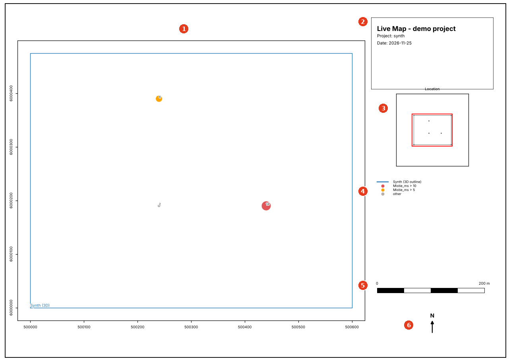

*Live Map - the Live Map's own PNG export (Export map (PNG / PDF)...). The window itself could not be drawn where this tutorial was built (no Qt on the build server); Install GeoHarmonic.bat rebuilds this page with the real window.*

1. Map: survey outline and wells styled by a demo column Mistie_ms (rule colours > 10 ms red, > 5 ms orange; bubble size + label = value)
2. Title block (title, project, date)
3. Location inset
4. Legend (layers + well style)
5. Scale bar
6. North arrow


*Horizon map - the horizon-map PNG export of the map hub. The window itself could not be drawn where this tutorial was built (no Qt on the build server); Install GeoHarmonic.bat rebuilds this page with the real window.*

1. Gridded horizon time with contours
2. Colour bar (ms)

### How it works

1. **Interpret > Horizon maps (structure, isochron, amplitude, depth)...** (**Ctrl+M**) grids a horizon onto the base map.
2. In **Map layers** click **Add...** for grids, CPS-3 files, petrophysics per well, mineral pies, shapefiles / culture (leases, PLSS, pipelines, no-go), DHI checklist, migration, grid calculator, cross-check, EPSG and GIS export.
3. **View > Live Map (styled wells, filters, linked table + crossplot)...**: in *Well style* choose *Colour by* / *Size by* / *Shape by* / *Label* columns (rules such as *mistie > 10 ms = red* under *Rules*), **Apply style**.
4. *Filters*: **Add filter** (range slider or category ticks) hides wells instantly; **Clear filters**.
5. **Lasso select** (click around wells, double-click to close) - the table, crossplot and histogram below follow; **Section from selected wells** opens them in the Well tool.
6. **Arbitrary line** (click points, double-click the last) opens an arbitrary section in the Seismic tool.
7. **Live grid...** grids a WellTable column or picks while you work; **Live depth maps** follow the dynamic depth model.
8. **Export map (PNG / PDF)...** with title block + legend; **Export GIS (shapefile, GeoJSON, ZMAP+)...**.

### Results

Map bus, styling, filters and gridding are tested without and with the GUI:

```
PASS 31b: nice scale bar (2500.0, 4, 2.5 km)
PASS 31b: north arrow = grid convergence (-1.997 vs 1.997 deg)
PASS 31b: rotated north arrow points east at +90 deg
PASS 31b: cursor readout (X 667,761.3  Y 5,875,194.3  |  53.00000 N  5.50000 E)
PASS 31e: shotpoint annotation every 100 + ends
PASS 31e: 2D lines annotated with shotpoints (26 labels)
PASS 31g: change -> coarse grid at once (cell x 4) in the same layer
PASS 31g: fault polygon is a barrier (jump 154 m vs 28 m without)
```
*8 of 9 matching test checks shown.*

### Known limits

- Polygon fills ignore holes; the Dashboard keeps its own selection (not yet on the bus).

### Troubleshooting

- *Wells do not light up across tools*: both tools must open the same well project (the bus files live in `<well project>_mapbus`).

<a id="basin"></a>

## 10. Basin model (burial, thermal, maturity) + Wheeler

**What it is for.** A 1D / pseudo-3D basin model in the spirit of PetroMod 1D / Genesis: decompaction and burial history, heat flow
and temperature, EASY%Ro maturity, timing of generation, all linked to the Wheeler diagram.

### How it looks

*Basin model dialog - not captured (no Qt on the build server - the window cannot be drawn here). Install GeoHarmonic.bat rebuilds the tutorial on your PC with a real screenshot.*

### How it works

1. **Interpret > Basin model (burial, thermal, maturity, Wheeler)...**.
2. Tab **Age table**: layers with ages, lithologies, erosion; tab **Wells**: the wells to model, heat flow; run. Tick **Re-run when the depth model changes** to keep it live.
3. Tab *Maps / Wheeler / events*: maturity maps, **Colour Wheeler (age)**, the events chart (source, reservoir, seal, trap, generation).

### Results

Checked against analytic solutions:

```
PASS Athy grain thickness 606.53 m and its inverse (base depth 1000 m)
PASS decompacted thickness at the surface 214.97 m == analytic 214.97 m
PASS steady state == analytic two-layer geotherm (max error 0.0000 degC)
PASS steady state with radiogenic heat == analytic T = Ts + (qs z - A z^2/2)/k (0.0000 degC)
PASS EASY%Ro at 2 degC/My: 0.57 @100, 1.04 @150, 2.09 @200 degC (published curve)
PASS EASY%Ro == independent quadrature at 200 degC (2.095 vs 2.095)
PASS 18e: Basin model window opens with the Taranaki age template
PASS 18e: age table + settings saved in the project
```
*8 of 21 matching test checks shown.*

### Known limits

- 1D per well / grid node (no lateral heat or fluid flow).

### Troubleshooting

- *Ro too high*: check the erosion amounts and heat flow history.

<a id="inversion"></a>

## 11. Seismic inversion (+ resolution, AVO / DHI)

**What it is for.** Hampson-Russell STRATA-style post-stack and pre-stack inversion: low-frequency model (LFM) from wells and horizons,
model-based / sparse-spike post-stack inversion, simultaneous pre-stack inversion (AI, SI, Vp/Vs), plus a
resolution / tuning check, single-well inversion and AVO / DHI / fizz-gas tools.

### How it looks

*Seismic inversion dialog - not captured (no Qt on the build server - the window cannot be drawn here). Install GeoHarmonic.bat rebuilds the tutorial on your PC with a real screenshot.*

### How it works

1. **Interpret > Seismic inversion (LFM, post-stack, pre-stack)...**.
2. Tab **Low-frequency model**: wells + horizons as the framework (or **along RGT stack levels instead**); tab **Post-stack** or **Pre-stack** to run; results are new volumes you can show on sections, in the 3D Viewer and as map layers.
3. **Resolution...** asks for the window, interval velocity and bed thicknesses and says which beds are resolved.
4. **AVO volumes (intercept, gradient, anomaly, fluid factor)** from a near and a far stack.

### Results

Inversion and AVO are tested on synthetic earths with known answers:

```
PASS 24a: dominant frequency of Ricker-30 data (32.2 Hz)
PASS 24a: usable band widens as the noise floor drops (62 -> 80 Hz)
PASS 24a: wedge tuning 14.00 ms = Kallweit-Wood 14.43 ms for a 30 Hz Ricker
PASS 24a: lambda/4 = 25 m, wedge tuning 21.0 m within 20 % of it
PASS 24a: thick beds: apparent = true thickness; tuning amplitude x1.44
PASS 24a: spectral balancing flattens the band and raises the centroid frequency (32 -> 35 Hz)
PASS 24a: recommendation - median bed 5.0 m needs ~150 Hz (lambda/4); data dominant 32 Hz, usable to 62 Hz; tuning 21.0 m now, 18.0 m after spectral balancing (14 % thinner); beds resolved 33 % -> 33 %
PASS 24b: two 90 deg phase rotations = polarity flip
```
*8 of 39 matching test checks shown.*

### Known limits

- Pre-stack gathers are not stored yet - angle stacks are used.

### Troubleshooting

- *Blocky result*: lower the sparsity weight or add a horizon to the LFM.

<a id="analytics"></a>

## 12. Analytics + Dashboard

**What it is for.** Transform / Spotfire-style data science: an attribute table (wells, laterals, grid values), feature engineering,
models with honest validation (spatial blocks), SHAP-style explanations and a QC report; and a Dashboard that colours
wells / laterals by any attribute, with spacing ellipses and a gun-barrel view.

### How it looks

*Analytics window - not captured (no Qt on the build server - the window cannot be drawn here). Install GeoHarmonic.bat rebuilds the tutorial on your PC with a real screenshot.*

*Dashboard window - not captured (no Qt on the build server - the window cannot be drawn here). Install GeoHarmonic.bat rebuilds the tutorial on your PC with a real screenshot.*

### How it works

1. **Interpret > Analytics (attribute table, models, SHAP)...**: build the table, pick target + inputs, train, read the *Model QC* report.
2. **Interpret > Dashboard (wells, laterals coloured by attribute)...**: **Wells from project**, **Add basemap grid**, **Stage CSV...**, colour by a column, **Send to Analytics**.
3. Reservoir engineering from the Dashboard toolbar: **Spacing + ellipses...** (SHmax azimuth asked), **Gun barrel**.

### Results

The models are validated on synthetic data with known drivers:

```
PASS edit changes the model only locally (inlines 4-36, window xl <= 48)
PASS wells inside the model: ['A-1', 'B-1', 'C-1']
PASS depth section: trough at 1160 m, model H2 1156 m
PASS 17a: 6 wells in the V0 + kZ model (6)
PASS 17a: constant-V0 model is worse on this earth (21.1 m vs 0.02 m)
PASS 17a: k = 0 reproduces the constant-velocity model (max diff 4.5e-13 m)
PASS 17a: cross-plot V_int vs mid depth (slope 0.519/s, R2 1.000, V0 per well ok)
PASS 17e: difference map between scenarios (max 21.1 m; same model 0)
```
*8 of 23 matching test checks shown.*

### Known limits

- Optional xgboost / scikit-learn / shap via *Install analytics extras (optional).bat*; numpy models otherwise.

### Troubleshooting

- *Too-good model*: use the spatial block validation, not random splits.

<a id="faultmap"></a>

## 13. Automated fault mapping

**What it is for.** PaleoScan AFE-style automatic faults: fault-likelihood, thinned fault likelihood (TFL), strike and dip volumes,
fault skins, a stereonet / rose QC, faults with sticks for the interpretation, throws and fault polygons on
horizons (used as gridding barriers).

### How it looks

*Automated fault mapping dialog - not captured (no Qt on the build server - the window cannot be drawn here). Install GeoHarmonic.bat rebuilds the tutorial on your PC with a real screenshot.*

### How it works

1. **Interpret > Automated fault mapping (fault likelihood, auto faults, polygons)...**.
2. **1. Fault likelihood volumes** (note the run time on F3).
3. **2. Extract faults**: set *TFL threshold* and *Minimum fault size (points)*; check the stereonet / strike rose; filter and merge in the table.
4. **3. Create faults (sticks)** - they appear in the Faults panel like hand-picked faults.
5. **Fault polygons on active horizon** for the map; **2D lines: fault cuts + correlation** for 2D.

### Results

Faults with known strike / dip / throw are recovered:

```
PASS 32a: fault likelihood in [0, 1], low away from faults (median 0.043)
PASS 32a: TFL peaks within 1 trace of fault 1 (708/710 plane points, median 0.50 traces)
PASS 32a: fault 1 strike 330 / dip 58 deg recovered within 5 deg (errors +0.1 / +2.0)
PASS 32a: TFL peaks within 1 trace of fault 2 (703/703 plane points, median 0.50 traces)
PASS 32a: fault 2 strike 150 / dip 58 deg recovered within 5 deg (errors +0.1 / +1.5)
PASS 32a: TFL peaks within 1 trace of fault 3 (459/486 plane points, median 0.00 traces)
PASS 32a: fault 3 strike 240 / dip 63 deg recovered within 5 deg (errors -0.0 / +0.4)
PASS 32a: thinned likelihood is 1-2 voxels wide (median 1.5)
```
*8 of 22 matching test checks shown.*

### Known limits

- Orientation from a structure tensor (not a brute-force scan) - same answer, much cheaper.

### Troubleshooting

- *Too many small faults*: raise the minimum size or the TFL threshold.

<a id="view3d"></a>

## 14. 3D Viewer

**What it is for.** A Petrel-style 3D window: inline / crossline / time-slice planes through the volume, horizons as surfaces, faults,
wells with tops, culture, vertical exaggeration and saved views. It uses your graphics card (OpenGL) and falls back
to software rendering when OpenGL cannot start (it says so in the title).

### How it looks


*3D Viewer - the 3D Viewer's own software renderer (the picture the window shows when OpenGL is not available). The window itself could not be drawn where this tutorial was built (no Qt on the build server); Install GeoHarmonic.bat rebuilds this page with the real window.*

1. Survey box
2. Inline / crossline planes (seismic, red-white-blue)
3. Horizon 'Top' coloured by time
4. Time-slice plane and horizon 'Deep'
5. Well W-1 (tube)

### How it works

1. Seismic tool: **View > 3D Viewer (slices, horizons, faults, wells)...** (**Ctrl+Shift+3**).
2. Mouse: left drag = orbit, middle drag or **Shift**+left = pan, wheel = zoom; **Fit** resets.
3. Move a plane with the *Inline* / *Crossline* / *Time slice* sliders - coarse while dragging, full resolution when you let go; the Seismic tool follows (and vice versa).
4. *Objects* tree: tick objects on / off, set opacity; the **VE** box in the toolbar sets vertical exaggeration.
5. **Save view**, **Screenshot...**, **Turntable GIF...**.

### Results

Planes, meshes, picking and the map-bus links are tested; on your PC the OpenGL path too:

```
PASS 33b: inline plane = one quad pair per cell (9552 triangles)
PASS 33b: slice colours come from the stored samples
PASS 33b: decimated plane while dragging (x16 fewer triangles)
PASS 33b: time slice flat at its time; crossline plane
PASS 33b: plane corners for the outline
PASS 33b: 2D line as a vertical curtain
PASS 33c: horizon surface - NaN holes open, fault not bridged (1034 of 1102 triangles)
PASS 33c: surface coloured by an attribute
```
*8 of 42 matching test checks shown.*

### Known limits

- Very large planes are drawn with per-vertex colours (decimated while dragging).

### Troubleshooting

- Title says *software rendering*: OpenGL could not start (remote desktop / driver). Update the NVIDIA driver; the reason is in the status bar.

<a id="glow"></a>

## 14b. Glow / Halo on horizons, faults and wells

**What it is for.** A PowerPoint-style glow (or a solid contrasting halo) under interpretation lines so horizons, faults and wells stand
out on busy seismic - in the section, the Live Map and the 3D Viewer. The active / selected object glows stronger;
selecting a horizon, fault or well in any window makes it glow in every window (map bus). Kingdom and Petrel have no
equivalent; it is closest to Petrel's "highlight selected object".

### How it looks


*Before: horizons and a fault without glow - the Seismic tool's own section export (File > Export section image) on the demo inline - glow as on screen. The window itself could not be drawn where this tutorial was built (no Qt on the build server); Install GeoHarmonic.bat rebuilds this page with the real window.*

1. Horizons Top / Deep, plain lines
2. Fault A

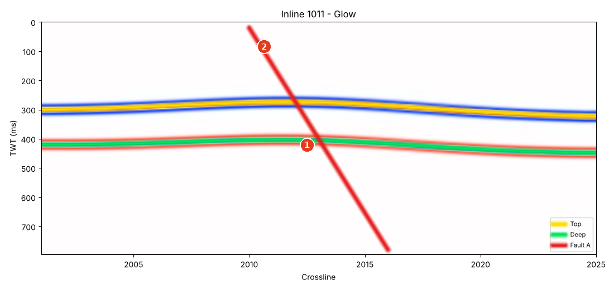

*After: Glow mode - the Seismic tool's own section export (File > Export section image) on the demo inline - glow as on screen. The window itself could not be drawn where this tutorial was built (no Qt on the build server); Install GeoHarmonic.bat rebuilds this page with the real window.*

1. Horizons Top / Deep with their glow
2. Fault A


*After: Halo mode - the Seismic tool's own section export (File > Export section image) on the demo inline - glow as on screen. The window itself could not be drawn where this tutorial was built (no Qt on the build server); Install GeoHarmonic.bat rebuilds this page with the real window.*

1. Horizons Top / Deep with a black halo
2. Fault A

### How it works

1. Seismic tool: press **G** (or **Display > Glow on/off**) to switch glow on / off everywhere.
2. **Display > Glow settings (mode, width, intensity, colour)...**: *Mode* Glow / Halo / Off, *Width* (pixels), *Intensity*, *Falloff layers* 1-4, *Glow colour* (match the object / white / black / custom), *Halo colour* (Auto picks black or white against the current colour table), *Glow only the active / selected object*, *Hover highlight*, *Exports include glow*. **Apply** or **OK**; saved with the project (**Ctrl+S**).
3. Quick switches: **Display > Glow mode: Glow**, **Display > Glow mode: Halo**, **Display > Glow only the active / selected object**.
4. Per object: right-click a horizon in the *Horizons* panel or a fault in the *Faults* panel (or an object in the 3D Viewer's *Objects* tree) > **Glow** > *On* / *Off* / *Use global* / *Colour...*.
5. Move the mouse over a horizon or fault on the section: it highlights (hover).
6. **File > Export section image (PNG / PDF / SVG)...** (**Ctrl+E**): choose *With glow (as shown)* or *Export without glow*. The 3D Viewer's **Screenshot...** asks the same; **Turntable GIF** follows the *Exports include glow* setting.
7. 3D Viewer: **Glow (G)** in the toolbar; surfaces get an outline glow, the active / selected one also a soft shell; wells a wider transparent tube; the three plane outlines glow.

### Results

The pictures above are the tool's own section export (before / Glow / Halo). The tests check:

```
PASS 39a: glow = 3 underlay strokes, outermost widest + faintest (widths [14.0, 10.0, 6.0], alpha [37, 104, 191])
PASS 39b: glow colour matches the object by default
PASS 39c: glow colour white / black / custom
PASS 39b: halo = one solid outline, black against the red-white-blue seismic (auto contrast)
PASS 39b: halo auto colour white on dark backgrounds / dark colour tables, black on light ones
PASS 39b: Off = no underlays
PASS 39c: falloff layers 1
PASS 39c: falloff layers 4
```
*8 of 74 matching test checks shown.*

### Known limits

- Pictures here are on the small demo cube; on F3 open an inline with your horizons and a fault and press G to compare.
- Wide glow lines in 3D depend on the graphics driver; when it cannot draw them the glow is 1 px wide or off, with a one-line note in the 3D status bar (never a crash).
- More than 2,000 glowing objects (e.g. thousands of fault sticks): glow switches to the active / selected objects only and the status bar says so.

### Troubleshooting

- *Nothing glows*: press **G** once (glow may be off), check **Display > Glow only the active / selected object** is unticked, and that the object has no per-object *Off*.
- *Glow looks too heavy*: Glow settings > Width 3-4 px, Intensity 50 %, or switch to Halo.

<a id="aesthetics"></a>

## 14c. Aesthetics: hillshade, colour tables, co-rendering, themes, figures

**What it is for.** Display polish shared by every window: sun-lit (hillshaded) maps and 3D surfaces, one colour-table library (seismic
bars incl. Kingdom-style, perceptual viridis / cividis / magma-style tables, colourblind-safe ones marked, your own
tables saved in the project), co-rendering of a second volume over the amplitude (like Petrel's co-render /
Kingdom's overlay), dark and light themes, smooth camera moves, styled well-log tracks and one-click figures with a
title block for slides and reports.

### How it looks

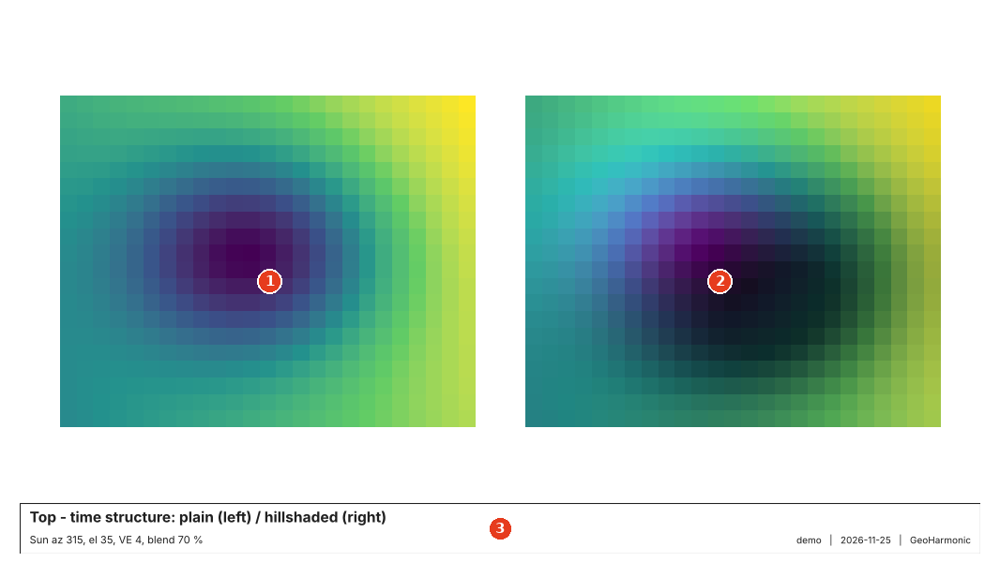

*Hillshaded horizon map - the figure export (Export section figure / compose_figure) with the 40a hillshade on the demo horizon. The window itself could not be drawn where this tutorial was built (no Qt on the build server); Install GeoHarmonic.bat rebuilds this page with the real window.*

1. Plain colour fill
2. Same map lit by the sun (hillshade)
3. Title block

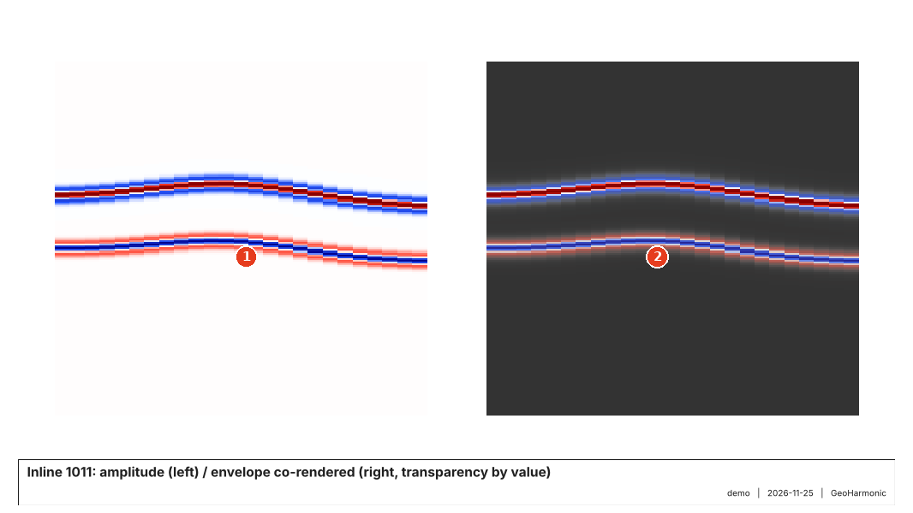

*Co-rendered envelope over amplitude - View > Co-render ... (aesthetics.corender) on the demo inline, shown with the figure export. The window itself could not be drawn where this tutorial was built (no Qt on the build server); Install GeoHarmonic.bat rebuilds this page with the real window.*

1. Amplitude, red-white-blue
2. Envelope over it, low values transparent


*Exported figure, dark theme - File > Export section figure (the code behind it) on the demo inline, dark theme. The window itself could not be drawn where this tutorial was built (no Qt on the build server); Install GeoHarmonic.bat rebuilds this page with the real window.*

1. Section with glowing horizons
2. Title block (title, project, author, date)
3. Scale bar
4. Colour bar + legend


*Exported figure, light theme - File > Export section figure (the code behind it) on the demo inline, light theme. The window itself could not be drawn where this tutorial was built (no Qt on the build server); Install GeoHarmonic.bat rebuilds this page with the real window.*

1. Section with glowing horizons
2. Title block (title, project, author, date)
3. Scale bar
4. Colour bar + legend


*Styled correlation panel - the Well Correlation Tool's section export with View > Track style turned on (bundled NZ wells). The window itself could not be drawn where this tutorial was built (no Qt on the build server); Install GeoHarmonic.bat rebuilds this page with the real window.*

1. Lithology column with patterns
2. GR gradient fill (sand yellow -> shale)
3. Neutron-density crossover shading

### How it works

1. **Sun / hillshade (maps):** Live Map toolbar **Sun...**: drag the sun on the dial (direction = azimuth, nearer the centre = higher), set *Vertical exaggeration*, *Blend with colour*, *Multi-directional*. Every grid on the map is lit; the 3D Viewer's horizons are lit by the same sun.
2. **Colour tables:** the colour box above the section lists the library; colourblind-safe tables are marked. Custom tables are saved with the project (export / import as JSON or a 256-row CSV).
3. **Co-render:** **View > Co-render a volume / attribute (alpha, multiply, transparency)...**: pick a second volume (e.g. coherence) or an attribute, the blend mode, its colour table and opacity. *Multiply* darkens the seismic where coherence is low; *transparency* hides low values. In 3D the same on the planes.
4. **Theme:** **View > Theme > Dark** or **Light (print / slides)** - switches immediately, remembered next time. **View > Anti-aliasing** off = faster drawing on huge sections.
5. **3D display:** 3D Viewer toolbar **Display...**: sun on/off, eye-dome lighting, fog, shadows (falls back to plain lighting), fly-to speed (Off / Fast / Normal / Slow). Selecting a well or horizon on the Live Map flies the 3D camera to it; any mouse click stops the move. Live Map **Zoom to selection** eases in.
6. **Well tracks (Well tool):** **View > Track style**: GR gradient fill, lithology patterns, net / pay flags (Vsh / PHIE / Sw cutoffs), neutron-density crossover; **Save track style as template...** / **Apply track template...**.
7. **Figures:** Seismic tool **File > Export section figure (title block, scale bar, legend)...**: page (16:9 slide, Letter, A4, poster), title; PNG / PDF / SVG. The 3D Viewer has the same for its view.
8. **Automatic colours:** new horizons / faults get colours that differ from each other and from the seismic colour table; right-click > **Lock colour**; **Display > Reassign horizon + fault colours**.

### Results

Pictures: the tools' own exports on the demo data. The tests check:

```
PASS 40a: slope / aspect of a plane = analytic (atan 0.3, faces west)
PASS 40a: hillshade = analytic Lambert value (sun az 270: 0.7848)
PASS 40a: hillshade = analytic Lambert value (sun az 315: 0.7158)
PASS 40a: hillshade = analytic Lambert value (sun az 90: 0.3140)
PASS 40a: dome lit from the NW is bright on its NW flank; multi-directional is softer
PASS 40a: time / depth maps (positive down): structural highs lit like hills
PASS 40a: vertical exaggeration strengthens the relief
PASS 40a: shading blends with the colour fill (flat ground keeps its colour; off = plain fill)
```
*8 of 93 matching test checks shown.*

### Known limits

- Eye-dome lighting and soft shadows are drawn by the software renderer (screenshots, fallback view); the OpenGL view shows plain lighting + fog.
- Theme: plot windows restyle immediately; a few dialogs keep their colours until reopened.
- High-DPI: tested here as maths (100 / 150 / 200 %); check on your 4K screen.
- ICS colours cover epochs / periods commonly mapped (Holocene to Cambrian).

### Troubleshooting

- *Map looks flat*: Sun... > raise Vertical exaggeration (time maps in ms need 3-10).
- *Theme did not change a window*: close and reopen that window.

<a id="conditioning"></a>

## 14d. Seismic conditioning (spikes, bandpass, FX decon, SOF, footprint)

**What it is for.** Post-stack conditioning like Petrel's structural smoothing / PaleoScan's SOF / OpendTect's dip-steered median: a
chain of steps with presets, a live preview with the difference panel, protect zones for geology you must not
smooth, and a full-volume run in the background that writes a NEW volume (the original is never changed). Your F3
test (2 passes, +/-2 IL x +/-3 XL) removed ~47 % of the RMS incl. real small faults at 1200-1350 ms - so the default
is 1 pass, edge protection on, a strength slider, and the difference panel is always shown.

### How it looks

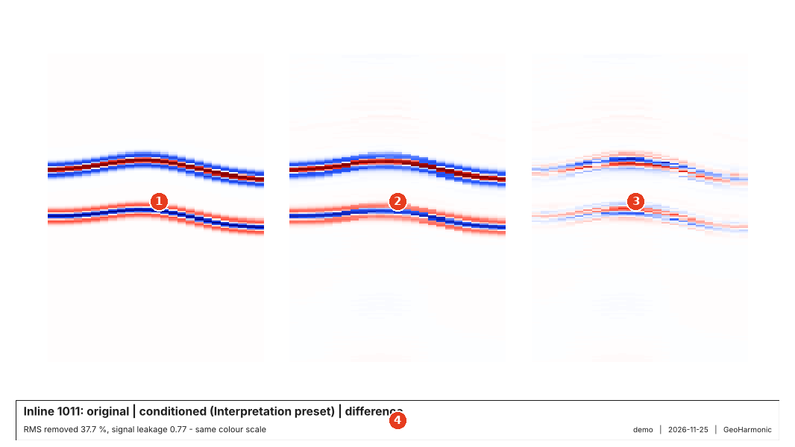

*Conditioning preview: original | conditioned | difference - the Conditioning preview computation (conditioning.apply_chain) on the demo cube, shown with the figure export. The window itself could not be drawn where this tutorial was built (no Qt on the build server); Install GeoHarmonic.bat rebuilds this page with the real window.*

1. Original
2. Conditioned
3. Difference (should look like noise)
4. QC numbers: RMS removed, signal leakage

### How it works

1. Seismic tool: open the line you want to judge (e.g. F3 inline 425), then **Seismic > Conditioning (spikes, bandpass, FX decon, SOF, footprint)...**.
2. *Input volume*: the volume (its conditioning history is shown in brackets). *Preset*: **Interpretation** (spike removal > bandpass > FX decon > SOF > footprint), **Light (for inversion)** (spikes > bandpass - the inversion window picks these volumes by default and warns on SOF volumes) or **Fault-attribute input** (spikes > SOF with strong edge protection).
3. Edit the chain: tick steps on / off, **Add** / **Remove** / **Up** / **Down**; select a step to see its parameters (JSON) - e.g. SOF `half_il`, `half_xl`, `filter` (median / alpha / mean), `passes`, `guard` (planarity threshold), `guard_mode` (shrink / skip), `kuwahara`, `strength` (0-1); bandpass `kind` (ormsby / butterworth) and `f` corners; FX decon window, `filter_len`, `fmin` / `fmax`, `mix`; then **Apply parameters**. **Save preset...** keeps the chain in the project.
4. **Preview**: original | conditioned | difference on one colour scale (zoom one, all follow), spectra before / after, *RMS removed %* and *signal leakage*. A warning appears when more than 35 % of the RMS is removed or the difference shows reflectors - then lower the strength or add a protect zone.
5. **Add zone...**: inline / crossline range + time gate + strength inside (0 = skip) - e.g. over the 1200-1350 ms small-fault interval. Zones go to the Live Map as polygons.
6. **Run full volume...**: name of the new volume; tick *Also write the difference volume* / *Export SEG-Y*. Runs in the background (progress, time left, Cancel in the status bar); the new volume appears in the seismic window, 3D Viewer, attributes, tracking and fault mapping.

### Results

The picture is the preview computation on the noise-free demo cube - a case for the warning: there is no noise to remove, the demo reflectors sit on whole samples (staircase), and the difference panel shows reflector energy, so the preview says *too aggressive* (RMS removed > 35 %). On real, noisy data the difference should look like random noise. The tests (synthetic cube with dipping reflectors, noise, a fault, footprint stripes and spikes) check:

```
PASS 41b: Ormsby bandpass matches the designed response (max error 0.020), zero phase
PASS 41b: Butterworth band = designed response (-3 dB at the corners)
PASS 41b: spectrum of the synthetic peaks near 30 Hz (24 Hz)
PASS 41b: spectral balancing (off by default) runs
PASS 41c: all 5 spikes found, no false positives (5 replaced)
PASS 41c: spike replaced by the neighbouring traces' median
PASS 41c: no false positives on clean data
PASS 41d: FX decon improves SNR on flat (+8.4 dB) and dipping (+8.1 dB) events
```
*8 of 47 matching test checks shown.*

### Known limits

- SEG-Y export writes GeoHarmonic's standard headers (inline / crossline / X / Y), not a copy of the original trace headers.
- Anisotropic diffusion (alternative SOF engine) is not built; AGC is available as a display-only step.
- Protect zones are rectangles in inline / crossline + a time gate (drawn polygons: next version).
- Full F3 run time: expect tens of minutes for SOF on 2 cores (the test cube runs in seconds).

### Troubleshooting

- *Difference shows reflectors*: strength 50-70 %, 1 pass, guard 0.6 with `skip`, or a protect zone.
- *Preview is slow*: the preview reads +/-12 inlines around the line; use a smaller SOF window.

<a id="surveyblend"></a>

## 14e. Survey horizon and grid blending (overlapping surveys)

**What it is for.** Two unmerged surveys that overlap never tie perfectly, even after the mistie correction (shift / phase / amplitude)
and depth conversion with each survey's velocities. A priority cut leaves a step at the seam; a fixed-width feather
smears geology. This blends only the RESIDUAL misfit with an adaptive width: width = |residual| / the slope you
allow (e.g. 2 m/km: a 4 m misfit gets 2 km, a 20 m misfit 10 km). Faults are barriers, so throw is kept, and well
tops are re-tied exactly afterwards.

### How it looks

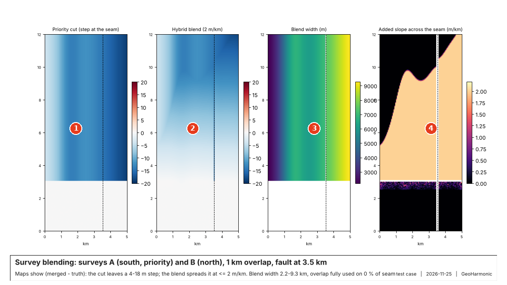

*Survey blending: cut vs blend, width and added-slope maps - Interpret > Survey horizon blending (surveyblend.blend) on the synthetic test case of the build (two surveys, residual tilt + bump, a fault across the seam). The window itself could not be drawn where this tutorial was built (no Qt on the build server); Install GeoHarmonic.bat rebuilds this page with the real window.*

1. Priority cut: step at the seam
2. Blended: misfit spread gently
3. Width: wide where the surveys disagree
4. Added slope stays <= 2 m/km

### How it works

1. Bulk-tie the surveys first (**Interpret > Mistie analysis**), and set up the velocity model (**Interpret > Velocity model + depth conversion**) if you blend in depth.
2. **Interpret > Survey horizon blending (adaptive seam, overlapping surveys)...**: choose the *Horizon*, *Survey A (priority)* and *Survey B*, *Domain* (Depth via the velocity model, or Time).
3. *Method*: **Hybrid** (default: residual surface into survey B, then a narrow feather), *Residual surface*, *Feather*, or *Priority cut* (no blending). *Allowed added slope* (default 2) in m/km, ft/mile or ms/km; *Min / Max width* and *Edge trim* (outer traces dropped) under Advanced.
4. Tick *Faults are barriers* and *Re-tie well tops* (uses the WellTable column `Top <horizon>`).
5. **Preview**; *Show*: merged grid, residual before, weight, width, added slope, correction; untick *Show blended* to compare with the priority cut. The readout says e.g. *Blend width 0.8-6.2 km, overlap fully used on 87 % of seam* - wide = the surveys disagree there (an interpretation flag).
6. **Export...**: merged grid + QC maps as ZMAP+ files; the merged grid, width and added-slope maps are added to the map hub (Live Map) layers.

### Results

The picture is the build's synthetic test case. The tests check:

```
PASS 42d/n: added slope across the seam never exceeds the tolerance (2.00 <= 2.0 m/km)
PASS 42l: total added slope (incl. the residual's own variation along the seam) reported as a separate map
PASS 42d: width = |residual| / slope, varying along the seam (2.2-9.3 km)
PASS 42n: no step at the seam - merged surface continuous (max 0.10 m beyond the true dip)
PASS 42n: overlap residual ~0 against the priority survey (median 0.000 m)
PASS 42h/n: fault throw preserved across the seam zone at y=3200 m (40.3 m vs 40 m)
PASS 42h/n: fault throw preserved across the seam zone at y=4500 m (40.3 m vs 40 m)
PASS 42h: the fault splits the map into two blocks (barrier)
```
*8 of 26 matching test checks shown.*

### Known limits

- Blends two surveys at a time (merge the result with the next survey).
- Depth mode uses one velocity model for both surveys (per-survey velocities: next version); it is not yet a step inside the depth-conversion dialog.
- Fault barriers come from the fault sticks' top points (one trace per fault).

### Troubleshooting

- *Width at the maximum everywhere*: the surveys still differ a lot - check the mistie tie first.
- *'gap' in the readout*: part of the seam has no overlap - that stretch is interpolation, not blending.

<a id="interp3d"></a>

## 15. 3D interpretation (picking, tracking, volume rendering, geobodies)

**What it is for.** Interpret directly in 3D: pick horizon points and fault sticks on the planes, track from 3D seeds, render an
amplitude / attribute volume with an opacity curve, and extract geobodies (connected bodies above a threshold) -
like Petrel's 3D interpretation and geobody tools.

### How it looks


*3D interpretation - the synthetic F3-like test project (same names and survey frame as F3; your F3 project was not found), drawn by the program's own export.*

1. Volume-rendered sub-volume (opacity slabs)

### How it works

1. In the 3D Viewer toolbar: **Pick horizon...** (choose or type a name), click on a plane (a click without dragging picks). **Stop picking** when done.
2. **Pick fault...**, click stick points, **End stick**.
3. **Track** grows the horizon from your 3D seeds (same tracker as the section).
4. **Volume...** shows another volume on the planes; **Volume render** draws a box of the volume with an opacity curve.
5. **Geobodies...**: *Keep values above:*, run; bodies are listed with volume / cell count, drawn in 3D and sent to the Live Map as outlines.

### Results

```
PASS 34d: closed surface of a sphere (every edge in 2 triangles, Euler 2, radius 11.8 vs 12.0)
PASS 34d: two known bodies labelled with exact cell counts
PASS 34d: a body touching the volume edge still gets a closed surface
PASS 34d: convex hull outline
PASS 34c: opacity curve
PASS 34c: integrated-graphics warning
PASS 34d: out-of-core labelling across inline blocks ([1479, 200] cells, volumes in m3)
PASS 34d: body footprint polygon for the Live Map
```
*8 of 20 matching test checks shown.*

### Known limits

- Tracking growth is shown when the run ends (not live).

### Troubleshooting

- *Clicks rotate instead of picking*: click without moving the mouse.

<a id="framework"></a>

## 16. Structural framework + 3D grid

**What it is for.** Petrel's structural framework + 3D grid in a simple stair-stepped form: fault traces, horizons gridded per fault
block with conformable / erosional rules, depth conversion, then a 3D grid (zones, layering, fault-block index)
exported as Eclipse GRDECL for ResInsight / OPM Flow.

### How it looks

*Structural framework + 3D grid dialog - not captured (no Qt on the build server - the window cannot be drawn here). Install GeoHarmonic.bat rebuilds the tutorial on your PC with a real screenshot.*

### How it works

1. **Interpret > Structural framework + 3D grid (GRDECL)...**.
2. **1. Framework (time)** - horizons per fault block, rules, no-crossing checks.
3. **2. Depth (current depth model)** - uses the layer-cake or the velocity-volume model.
4. **3. 3D grid** - cell size, layers per zone; the quality report lists zero-thickness cells.
5. **Export GRDECL...** (ZONE / FAULTBLK / FIPNUM included); open it in ResInsight.
6. **4. Properties + volumetrics...** opens chapter 17 on this grid.

### Results

```
PASS 35b: two fault blocks either side of the fault
PASS 35b: horizons gridded per fault block (median errors [0.0, 0.12, 0.0] m)
PASS 35b: fault-block throw honoured at the fault (60.0 m, true 60.0)
PASS 35b: no crossing horizons after the rules (before [10, 4])
PASS 35b: erosional surface truncates the horizon below it
PASS 35a: fault trace where the fault surface cuts the horizon
PASS 35a: fault editing - smooth, remove a stick
PASS 35c: framework converted to depth through a velocity model
```
*8 of 19 matching test checks shown.*

### Known limits

- Stair-stepped faults with vertical pillars; full corner-point grids are out of scope.

### Troubleshooting

- *Negative thickness cells*: check the horizon rules (erosional / base).

<a id="properties"></a>

## 17. Property modelling + volumetrics

**What it is for.** Petrel property modelling in brief: upscale logs into the grid, variograms per zone, facies (SIS / indicator
kriging) and petrophysics (kriging / SGS) with fixed-seed realizations, then GRV / NTG / porosity / Sw / Bo
volumetrics per zone and fault block with P90 / P50 / P10.

### How it looks

*Property modelling + volumetrics dialog - not captured (no Qt on the build server - the window cannot be drawn here). Install GeoHarmonic.bat rebuilds the tutorial on your PC with a real screenshot.*

### How it works

1. Open from the framework dialog: **4. Properties + volumetrics...**.
2. **Upscale logs** (arithmetic / harmonic / geometric / most-of), check the raw vs upscaled plot.
3. **Variogram** per zone, then **Simulate (10 realizations)**.
4. **Volumetrics per block** with contacts and Bo / Bg; **Export GRDECL / CSV...**.

### Results

```
PASS 36a: upscaling - one value per cell the well crosses (arithmetic 0.1345 = 0.1345)
PASS 36a: harmonic <= geometric <= arithmetic
PASS 36a: discrete facies upscaled with 'most of'
PASS 36d: kriging exact at the data cells, bounded between them
PASS 36d: SGS reproduces the input histogram (mean 0.192, std 0.027); seeds differ
PASS 36d: fixed seed -> same realization
PASS 36b/36d: SGS realization honours the variogram model (experimental vs model)
PASS 36b: variogram fit (sill 0.00068, range 407 m)
```
*8 of 24 matching test checks shown.*

### Known limits

- SGS / SIS are per-cell loops - fine to ~100,000 cells.

### Troubleshooting

- Sw is constant 0.3 when no Sw log is upscaled.

<a id="prospects"></a>

## 18. Prospects, migration, seal, spacing, depletion

**What it is for.** Exploration and development tools built on the map hub: DHI checklist and Rose-style prospect risking +
volumetrics, migration (flow paths, traps, fill-spill), fault / top seal, structural timing, well spacing with
drainage ellipses and gun-barrel views, depletion / remaining resource and an M&A screen.

### How it looks


*Prospects, migration and spacing - the synthetic F3-like test project (same names and survey frame as F3; your F3 project was not found), drawn by the program's own export.*

1. Migration traps (fill-spill)
2. Drainage ellipses

### How it works

1. **Map layers > Add... > DHI checklist (amplitude grid vs structure grid)...** - scores the DHI evidence and stores a prospect row (risk + volumetrics).
2. **Map layers > Add... > Migration: flow paths, traps, fill-spill on the selected depth grid**.
3. **Interpret > Paleo-structure animation of this section (GIF)...** for structural timing.
4. Dashboard toolbar: **Spacing + ellipses...**, **Gun barrel**.

### Results

```
PASS 26a: expansion index per interval [1.0, 1.0, 1.6, 1.6, 1.0], throw grows with depth
PASS 26a: proposed phases from the growth {'H0': 'post-rift', 'H1': 'post-rift', 'H2': 'syn-rift', 'H3': 'syn-rift', 'H4': 'pre-rift'}
PASS 26b: decompacted paleo-depth (unit 800 m now -> 1091 m at H1 time, grains conserved)
PASS 26c: block restoration of the fault returns the unfaulted layers (throw 30.0 ms, rel. error 0.000)
PASS 27a: cone - one trap at the crest, spill depth at the nearest edge (y = 0, 30 m closure)
PASS 27a: dome + saddle - deeper trap spills at the saddle (column 54) into the up-dip trap, which leaks
PASS 27b: sand-on-sand windows (S1/S1 10 m, S2/S2 20 m) where the throw is smaller than the sands
PASS 27b: shale gouge ratio of alternating 10 m beds over a 20 m throw = 0.5
```
*8 of 33 matching test checks shown.*

### Known limits

- There is no separate prospect window yet (prospects live in the project and the map hub).

<a id="rebuild"></a>

## 19. Rebuilding this tutorial

The tutorial is generated, never edited by hand: `dev/build_tutorial.py` runs the F3 worked example (`dev/tutorial_f3.py`,
on `Documents\F3 Netherlands` when it exists - a working copy, your project is not changed - else on the synthetic
F3-like project), builds the demo project for the tool chapters, opens every window, captures the screenshots, adds
the callouts and writes `TUTORIAL.md`, `TUTORIAL.html`, `TUTORIAL.pdf` (letter) and `tutorial_build_log.txt`. On your
PC, **Install GeoHarmonic.bat** runs it with real Qt and writes `tutorial_local\TUTORIAL.html` (the desktop
shortcut opens that copy).

### How it works

1. Nothing to do - the installer rebuilds it. Claude re-runs it after every change to a window.

